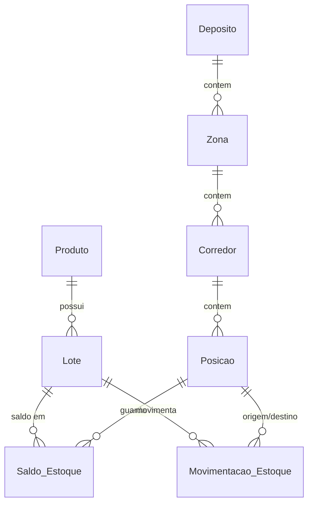

# Salesforce WMS

WMS (Warehouse Management System) nativo Salesforce: estrutura hierárquica de armazém, produtos com rastreio por lote e validade, ledger imutável de movimentações com saldo derivado, sugestão FEFO, painel operacional em LWC, relatórios e dashboard.

## Funcionalidades

- **Hierarquia de armazém:** Depósito → Zona → Corredor → Posição
- **Produtos e lotes** com data de fabricação e validade
- **Entrada, Saída e Transferência** registradas em um ledger imutável (`Movimentacao_Estoque__c`)
- **Saldo derivado** (`Saldo_Estoque__c`), nunca editado manualmente; saída acima do saldo é bloqueada
- **FEFO:** sugestão automática do lote de vencimento mais próximo
- **Painel Operacional** (LWC): registrar movimentação, visão de ocupação do depósito, alerta de validade
- **Relatórios e Dashboard** "WMS – Visão Geral"
- **Permission Sets:** `WMS_Operador` e `WMS_Gestor`

## Arquitetura

```
Usuário registra Movimentacao_Estoque__c
  → before insert: MovimentacaoValidator (estrutura, lote vencido, posição ativa, saldo)
  → after insert: SaldoEstoqueService (upsert agregado em Saldo_Estoque__c)
```

Modelo de dados:



Apex: `TriggerHandler` (framework), `MovimentacaoEstoqueTriggerHandler`, `SaldoEstoqueTriggerHandler` (guarda: o saldo só muda pelo Apex), `LoteTriggerHandler`, `MovimentacaoValidator`, `SaldoEstoqueService`, `FefoService`, `WmsController`, `ErrorLogger` (publica `Log_Erro_Evento__e`, um Platform Event de publicação imediata que grava `Log_Erro__c` e sobrevive ao rollback).

Modos de acesso: a lógica que mantém o saldo derivado (`SaldoEstoqueService`, `MovimentacaoValidator`, `ErrorLogger`) roda em `SYSTEM_MODE`, porque nenhum usuário pode escrever em `Saldo_Estoque__c`; as classes expostas ao LWC (`WmsController`, `FefoService`) rodam em `USER_MODE` e respeitam as permissões do usuário.

## Instalação

Pré-requisitos: Salesforce CLI (`sf`), Node.js e um org autenticado.

```bash
sf org login web --alias dev-org
npm install
sf project deploy start --source-dir force-app --target-org dev-org
sf org assign permset --name WMS_Gestor --target-org dev-org
sf apex run --file scripts/apex/seed.apex --target-org dev-org   # dados de demonstração
```

Atribua `WMS_Gestor` (ou `WMS_Operador`) a cada usuário que for usar o app: os campos customizados não recebem permissão de campo automaticamente, e o Apex respeita essas permissões. Abra o app **WMS** no App Launcher.

## Testes

```bash
npm run test:unit                       # LWC (Jest)
sf apex run test --test-level RunLocalTests --target-org dev-org --code-coverage --synchronous
```

## Regras de negócio

- Movimentações são imutáveis; correções são feitas por movimentação compensatória.
- Nenhum usuário edita `Saldo_Estoque__c`; apenas o Apex.
- Lotes vencidos não podem ser movimentados; lotes sem validade nunca são considerados vencidos.

## Fora do escopo (próximos recortes)

Recebimento/putaway, picking e expedição, contagem cíclica, número de série, leitor de código de barras/mobile.
