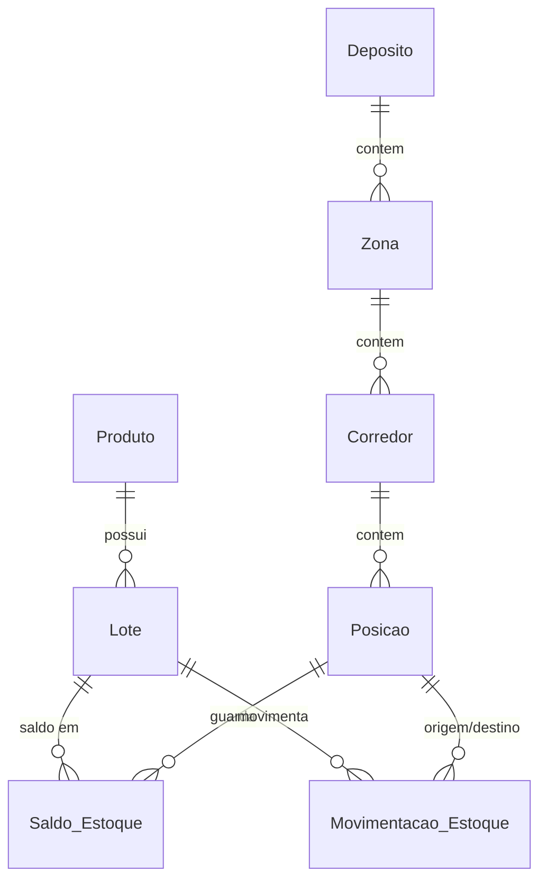

# Salesforce WMS (Recorte 1) Implementation Plan

> **For agentic workers:** REQUIRED SUB-SKILL: Use superpowers:subagent-driven-development (recommended) or superpowers:executing-plans to implement this plan task-by-task. Steps use checkbox (`- [ ]`) syntax for tracking.

**Goal:** Construir, no org `dev-org`, o núcleo de inventário e estrutura de armazém de um WMS (hierarquia de armazém, produtos, lotes com validade, ledger imutável de movimentações com saldo derivado, FEFO, LWC operacionais, relatórios/dashboard e Permission Sets).

**Architecture:** Projeto SFDX (metadata-as-code) com objetos 100% customizados. Toda movimentação é um registro imutável de `Movimentacao_Estoque__c`; um trigger framework (`TriggerHandler` + handlers) valida (`MovimentacaoValidator`) e aplica (`SaldoEstoqueService`) a movimentação em `Saldo_Estoque__c`, que é sempre derivado. Três LWC consomem `FefoService` e `WmsController`.

**Tech Stack:** Salesforce API 67.0, Apex, Lightning Web Components, Jest (`@salesforce/sfdx-lwc-jest`), Salesforce CLI (`sf`), MCP Salesforce (`run_code_analyzer`).

**Spec:** `docs/superpowers/specs/2026-10-06-salesforce-wms-design.md`

## Global Constraints

- Projeto em `C:\Users\iuril\Documents\workspace\projects\salesforce-wms`; metadados em `force-app/main/default`; `sourceApiVersion` = `67.0`.
- Desenvolvimento e deploy direto no org `dev-org` (Developer Edition "EconoPRO"); **sem scratch orgs**.
- Objetos customizados, sem `Product2`: `Deposito__c`, `Zona__c`, `Corredor__c`, `Posicao__c`, `Produto__c`, `Lote__c`, `Saldo_Estoque__c`, `Movimentacao_Estoque__c`, `Log_Erro__c`.
- `Saldo_Estoque__c` é sempre derivado, somente leitura para todos (FLS/permissões); só o Apex escreve.
- `Movimentacao_Estoque__c` é imutável: ninguém tem Edit/Delete; correção = movimentação compensatória.
- Unicidade do par Lote+Posição em `Saldo_Estoque__c` via `Chave__c` (External Id único).
- Saída/transferência acima do saldo é bloqueada em Apex (`MovimentacaoValidator`, before insert), não por Validation Rule.
- Todo Apex bulkificado: sem SOQL/DML em loop; testado com 200 registros.
- Classes Apex expostas ao LWC usam `with sharing`.
- Cobertura Apex ≥ 90%; testes sem `SeeAllData`; dados via `TestDataFactory`.
- Jest para as três LWC; `run_code_analyzer` antes do deploy final.
- Permission Sets: `WMS_Operador` e `WMS_Gestor`.
- Valores de picklist `Tipo__c` (API): `Entrada`, `Saida`, `Transferencia`.

## Convenções de comando (valem para todas as tasks)

Em cada nova sessão PowerShell, o `sf` precisa entrar no PATH:

```powershell
$env:Path += ";C:\Program Files\sf\bin"
```

- **DEPLOY** = `sf project deploy start --source-dir force-app --target-org dev-org --test-level NoTestRun`
  (se o org recusar `NoTestRun`, troque por `--test-level RunLocalTests`).
- **TESTAR Apex** = `sf apex run test --class-names <Classe> --target-org dev-org --result-format human --code-coverage --synchronous --wait 10`
- **Jest** = `npm run test:unit` (a partir de `salesforce-wms/`)
- Todos os comandos rodam a partir de `C:\Users\iuril\Documents\workspace\projects\salesforce-wms`.

## Templates de metadados (usados nas tasks 2, 3 e 4)

Cada campo é um arquivo `force-app/main/default/objects/<Objeto>/fields/<Campo>.field-meta.xml`. Substitua os `{PLACEHOLDERS}` pelos parâmetros da tabela do campo; omita as linhas marcadas "(se aplicável)" quando o parâmetro não existir.

**T-TEXT**
```xml
<?xml version="1.0" encoding="UTF-8"?>
<CustomField xmlns="http://soap.sforce.com/2006/04/metadata">
    <fullName>{API}</fullName>
    <label>{LABEL}</label>
    <type>Text</type>
    <length>{LEN}</length>
    <required>{REQUIRED}</required>
    <unique>false</unique>
    <externalId>false</externalId>
</CustomField>
```

**T-TEXT-UNIQUE** (texto único, case-sensitive; `externalId` conforme tabela)
```xml
<?xml version="1.0" encoding="UTF-8"?>
<CustomField xmlns="http://soap.sforce.com/2006/04/metadata">
    <fullName>{API}</fullName>
    <label>{LABEL}</label>
    <type>Text</type>
    <length>{LEN}</length>
    <required>true</required>
    <unique>true</unique>
    <caseSensitive>true</caseSensitive>
    <externalId>{EXTERNAL_ID}</externalId>
</CustomField>
```

**T-LONGTEXT**
```xml
<?xml version="1.0" encoding="UTF-8"?>
<CustomField xmlns="http://soap.sforce.com/2006/04/metadata">
    <fullName>{API}</fullName>
    <label>{LABEL}</label>
    <type>LongTextArea</type>
    <length>32768</length>
    <visibleLines>5</visibleLines>
</CustomField>
```

**T-NUMBER**
```xml
<?xml version="1.0" encoding="UTF-8"?>
<CustomField xmlns="http://soap.sforce.com/2006/04/metadata">
    <fullName>{API}</fullName>
    <label>{LABEL}</label>
    <type>Number</type>
    <precision>18</precision>
    <scale>2</scale>
    <required>{REQUIRED}</required>
    <defaultValue>{DEFAULT}</defaultValue> <!-- (se aplicável) -->
    <externalId>false</externalId>
</CustomField>
```

**T-CHECKBOX**
```xml
<?xml version="1.0" encoding="UTF-8"?>
<CustomField xmlns="http://soap.sforce.com/2006/04/metadata">
    <fullName>{API}</fullName>
    <label>{LABEL}</label>
    <type>Checkbox</type>
    <defaultValue>{DEFAULT}</defaultValue>
</CustomField>
```

**T-DATE** / **T-DATETIME** (`{TYPE}` = `Date` ou `DateTime`)
```xml
<?xml version="1.0" encoding="UTF-8"?>
<CustomField xmlns="http://soap.sforce.com/2006/04/metadata">
    <fullName>{API}</fullName>
    <label>{LABEL}</label>
    <type>{TYPE}</type>
    <required>false</required>
</CustomField>
```

**T-PICKLIST** (repita o bloco `<value>` para cada valor da tabela; `<default>true</default>` só no valor padrão)
```xml
<?xml version="1.0" encoding="UTF-8"?>
<CustomField xmlns="http://soap.sforce.com/2006/04/metadata">
    <fullName>{API}</fullName>
    <label>{LABEL}</label>
    <type>Picklist</type>
    <required>true</required>
    <valueSet>
        <restricted>true</restricted>
        <valueSetDefinition>
            <sorted>false</sorted>
            <value>
                <fullName>{VALOR_API}</fullName>
                <default>{true|false}</default>
                <label>{VALOR_LABEL}</label>
            </value>
        </valueSetDefinition>
    </valueSet>
</CustomField>
```

**T-LOOKUP**
```xml
<?xml version="1.0" encoding="UTF-8"?>
<CustomField xmlns="http://soap.sforce.com/2006/04/metadata">
    <fullName>{API}</fullName>
    <label>{LABEL}</label>
    <type>Lookup</type>
    <referenceTo>{REF}</referenceTo>
    <relationshipLabel>{REL_LABEL}</relationshipLabel>
    <relationshipName>{REL_NAME}</relationshipName>
    <required>{REQUIRED}</required>
    <deleteConstraint>{DELETE}</deleteConstraint>
</CustomField>
```
(`{DELETE}` = `Restrict` quando `required=true`; `SetNull` quando `required=false`.)

**T-FORMULA** (`{TYPE}` = `Text` ou `Date`)
```xml
<?xml version="1.0" encoding="UTF-8"?>
<CustomField xmlns="http://soap.sforce.com/2006/04/metadata">
    <fullName>{API}</fullName>
    <label>{LABEL}</label>
    <type>{TYPE}</type>
    <formula>{FORMULA}</formula>
    <formulaTreatBlanksAs>BlankAsZero</formulaTreatBlanksAs>
</CustomField>
```

**T-OBJETO** (`force-app/main/default/objects/<Objeto>/<Objeto>.object-meta.xml`; `{NAME_FIELD}` é o bloco `<nameField>` indicado em cada task)
```xml
<?xml version="1.0" encoding="UTF-8"?>
<CustomObject xmlns="http://soap.sforce.com/2006/04/metadata">
    <label>{LABEL}</label>
    <pluralLabel>{PLURAL}</pluralLabel>
    {NAME_FIELD}
    <deploymentStatus>Deployed</deploymentStatus>
    <sharingModel>ReadWrite</sharingModel>
    <enableReports>true</enableReports>
    <enableSearch>true</enableSearch>
    <enableActivities>false</enableActivities>
    <enableHistory>false</enableHistory>
    <enableBulkApi>true</enableBulkApi>
    <enableSharing>true</enableSharing>
    <enableStreamingApi>true</enableStreamingApi>
</CustomObject>
```
Bloco de nome texto: `<nameField><label>{NOME_LABEL}</label><type>Text</type></nameField>`
Bloco auto-number: `<nameField><displayFormat>{PREFIXO}-{000000}</displayFormat><label>Número</label><startingNumber>1</startingNumber><type>AutoNumber</type></nameField>`

## Review Focus

Entradas que a spec implica mas nenhuma tarefa óbvia cobriria; cada uma tem teste na task indicada:

1. Lote de 200 saídas do mesmo lote/posição no mesmo DML: saldos acumulados na própria transação, nunca estourando o saldo (Task 8 e 9).
2. Quantidade zero, negativa ou nula: rejeitada com mensagem clara (Task 8).
3. Transferência com posição de origem igual à de destino: rejeitada (Task 8).
4. Lote sem data de validade (nulo): aceito na validação e ordenado por último no FEFO, nunca tratado como vencido (Task 8 e 11).
5. Posição sem capacidade (nula ou 0) na visão do depósito: ocupação 0%, sem divisão por zero (Task 12).

---

### Task 1: Scaffold do projeto SFDX

**Files:**
- Create: `sfdx-project.json`, `.forceignore`, `.gitignore`, `package.json`, `jest.config.js`, `force-app/main/default/.gitkeep`

**Interfaces:**
- Produces: projeto implantável (`DEPLOY`) e runner Jest (`npm run test:unit`).

- [ ] **Step 1: Criar `sfdx-project.json`**

```json
{
  "packageDirectories": [{ "path": "force-app", "default": true }],
  "name": "salesforce-wms",
  "namespace": "",
  "sfdcLoginUrl": "https://login.salesforce.com",
  "sourceApiVersion": "67.0"
}
```

- [ ] **Step 2: Criar `.forceignore`**

```
package.xml
**/jsconfig.json
**/.eslintrc.json
**/__tests__/**
```

- [ ] **Step 3: Criar `.gitignore`**

```
node_modules/
.sf/
.sfdx/
.localdevserver/
coverage/
*.log
```

- [ ] **Step 4: Criar `package.json` e `jest.config.js`**

`package.json`:
```json
{
  "name": "salesforce-wms",
  "private": true,
  "version": "1.0.0",
  "scripts": {
    "test:unit": "sfdx-lwc-jest",
    "test:unit:coverage": "sfdx-lwc-jest --coverage"
  }
}
```

`jest.config.js`:
```js
const { jestConfig } = require('@salesforce/sfdx-lwc-jest/config');

module.exports = {
    ...jestConfig,
    modulePathIgnorePatterns: ['<rootDir>/.localdevserver']
};
```

- [ ] **Step 5: Instalar o runner Jest e criar a pasta de metadados**

Run:
```bash
npm install --save-dev @salesforce/sfdx-lwc-jest
mkdir -p force-app/main/default && touch force-app/main/default/.gitkeep
```
Expected: `node_modules/` criado e `package.json` com `devDependencies`.

- [ ] **Step 6: Verificar conexão e validar o projeto**

Run (PowerShell): `$env:Path += ";C:\Program Files\sf\bin"; sf org display --target-org dev-org`
Expected: `Connected Status`, Org Id `00DgK00000baonNUAQ`.

Run: `sf project deploy start --source-dir force-app --target-org dev-org --dry-run`
Expected: `Deploy Succeeded` (ou "No source-backed components"), sem erro de configuração.

- [ ] **Step 7: Commit**

```bash
git add sfdx-project.json .forceignore .gitignore package.json package-lock.json jest.config.js force-app/main/default/.gitkeep
git commit -m "chore: scaffold SFDX project with Jest runner"
```

---

### Task 2: Objetos da hierarquia de armazém

**Files:**
- Create: `force-app/main/default/objects/{Deposito__c,Zona__c,Corredor__c,Posicao__c}/<Objeto>.object-meta.xml` e `fields/*.field-meta.xml` conforme tabelas.

**Interfaces:**
- Produces: `Deposito__c`(Endereco__c, Ativo__c); `Zona__c`(Deposito__c, Tipo__c); `Corredor__c`(Zona__c); `Posicao__c`(Corredor__c, Capacidade_Maxima__c, Ativa__c). Relationship names filhos: `Zonas`, `Corredores`, `Posicoes`.

- [ ] **Step 1: Criar os 4 arquivos de objeto a partir de T-OBJETO**

| Objeto | LABEL | PLURAL | NAME_FIELD |
|---|---|---|---|
| `Deposito__c` | Depósito | Depósitos | texto, label `Nome` |
| `Zona__c` | Zona | Zonas | texto, label `Nome` |
| `Corredor__c` | Corredor | Corredores | texto, label `Nome` |
| `Posicao__c` | Posição | Posições | texto, label `Código` |

- [ ] **Step 2: Criar os campos (um arquivo por linha, pelo template indicado)**

| Objeto | API | LABEL | Template | Parâmetros |
|---|---|---|---|---|
| Deposito__c | `Endereco__c` | Endereço | T-TEXT | LEN=255, REQUIRED=false |
| Deposito__c | `Ativo__c` | Ativo | T-CHECKBOX | DEFAULT=true |
| Zona__c | `Deposito__c` | Depósito | T-LOOKUP | REF=Deposito__c, REL_LABEL=Zonas, REL_NAME=Zonas, REQUIRED=true, DELETE=Restrict |
| Zona__c | `Tipo__c` | Tipo | T-PICKLIST | valores: `Recebimento`/Recebimento, `Armazenagem`/Armazenagem (default), `Expedicao`/Expedição |
| Corredor__c | `Zona__c` | Zona | T-LOOKUP | REF=Zona__c, REL_LABEL=Corredores, REL_NAME=Corredores, REQUIRED=true, DELETE=Restrict |
| Posicao__c | `Corredor__c` | Corredor | T-LOOKUP | REF=Corredor__c, REL_LABEL=Posições, REL_NAME=Posicoes, REQUIRED=true, DELETE=Restrict |
| Posicao__c | `Capacidade_Maxima__c` | Capacidade Máxima | T-NUMBER | REQUIRED=false (sem DEFAULT) |
| Posicao__c | `Ativa__c` | Ativa | T-CHECKBOX | DEFAULT=true |

- [ ] **Step 3: Deploy**

Run: DEPLOY
Expected: `Deploy Succeeded` com 4 objetos e 8 campos.

- [ ] **Step 4: Verificar no org**

Run: `sf data query --query "SELECT QualifiedApiName FROM EntityDefinition WHERE QualifiedApiName IN ('Deposito__c','Zona__c','Corredor__c','Posicao__c')" --target-org dev-org`
Expected: 4 linhas.

- [ ] **Step 5: Commit**

```bash
git add force-app/main/default/objects
git commit -m "feat: add warehouse hierarchy objects (deposito, zona, corredor, posicao)"
```

---

### Task 3: Objetos Produto e Lote

**Files:**
- Create: `objects/Produto__c/**`, `objects/Lote__c/**`

**Interfaces:**
- Consumes: nada.
- Produces: `Produto__c`(SKU__c, Unidade_Medida__c, Estoque_Minimo__c); `Lote__c`(Produto__c, Data_Fabricacao__c, Data_Validade__c, Quantidade_Recebida__c, Produto_Nome__c). Name de `Lote__c` = número do lote. Relationship `Lotes`.

- [ ] **Step 1: Criar os 2 objetos (T-OBJETO)**

| Objeto | LABEL | PLURAL | NAME_FIELD |
|---|---|---|---|
| `Produto__c` | Produto | Produtos | texto, label `Nome` |
| `Lote__c` | Lote | Lotes | texto, label `Número do Lote` |

- [ ] **Step 2: Criar os campos**

| Objeto | API | LABEL | Template | Parâmetros |
|---|---|---|---|---|
| Produto__c | `SKU__c` | SKU | T-TEXT-UNIQUE | LEN=40, EXTERNAL_ID=true |
| Produto__c | `Unidade_Medida__c` | Unidade de Medida | T-PICKLIST | `UN`/UN (default), `KG`/KG, `L`/L, `CX`/CX |
| Produto__c | `Estoque_Minimo__c` | Estoque Mínimo | T-NUMBER | REQUIRED=false, DEFAULT=0 |
| Lote__c | `Produto__c` | Produto | T-LOOKUP | REF=Produto__c, REL_LABEL=Lotes, REL_NAME=Lotes, REQUIRED=true, DELETE=Restrict |
| Lote__c | `Data_Fabricacao__c` | Data de Fabricação | T-DATE | TYPE=Date |
| Lote__c | `Data_Validade__c` | Data de Validade | T-DATE | TYPE=Date |
| Lote__c | `Quantidade_Recebida__c` | Quantidade Recebida | T-NUMBER | REQUIRED=false (sem DEFAULT) |
| Lote__c | `Produto_Nome__c` | Nome do Produto | T-FORMULA | TYPE=Text, FORMULA=`Produto__r.Name` |

- [ ] **Step 3: Deploy**

Run: DEPLOY
Expected: `Deploy Succeeded`.

- [ ] **Step 4: Commit**

```bash
git add force-app/main/default/objects
git commit -m "feat: add produto and lote objects"
```

---

### Task 4: Objetos Saldo, Movimentação e Log de Erro

**Files:**
- Create: `objects/Saldo_Estoque__c/**`, `objects/Movimentacao_Estoque__c/**`, `objects/Log_Erro__c/**`

**Interfaces:**
- Consumes: `Lote__c`, `Posicao__c`.
- Produces: `Saldo_Estoque__c`(Lote__c, Posicao__c, Quantidade_Atual__c, Chave__c, Produto_Nome__c, Data_Validade__c, Deposito_Nome__c, Zona_Nome__c); `Movimentacao_Estoque__c`(Tipo__c, Lote__c, Posicao_Origem__c, Posicao_Destino__c, Quantidade__c, Data_Hora__c, Usuario_Responsavel__c, Status__c); `Log_Erro__c`(Origem__c, Mensagem__c, Stack_Trace__c).

- [ ] **Step 1: Criar os 3 objetos (T-OBJETO)**

| Objeto | LABEL | PLURAL | NAME_FIELD |
|---|---|---|---|
| `Saldo_Estoque__c` | Saldo de Estoque | Saldos de Estoque | auto-number, PREFIXO=`SLD` |
| `Movimentacao_Estoque__c` | Movimentação de Estoque | Movimentações de Estoque | auto-number, PREFIXO=`MOV` |
| `Log_Erro__c` | Log de Erro | Logs de Erro | auto-number, PREFIXO=`LOG` |

- [ ] **Step 2: Criar os campos**

| Objeto | API | LABEL | Template | Parâmetros |
|---|---|---|---|---|
| Saldo_Estoque__c | `Lote__c` | Lote | T-LOOKUP | REF=Lote__c, REL_LABEL=Saldos, REL_NAME=Saldos, REQUIRED=true, DELETE=Restrict |
| Saldo_Estoque__c | `Posicao__c` | Posição | T-LOOKUP | REF=Posicao__c, REL_LABEL=Saldos, REL_NAME=Saldos, REQUIRED=true, DELETE=Restrict |
| Saldo_Estoque__c | `Quantidade_Atual__c` | Quantidade Atual | T-NUMBER | REQUIRED=true, DEFAULT=0 |
| Saldo_Estoque__c | `Chave__c` | Chave (Lote-Posição) | T-TEXT-UNIQUE | LEN=40, EXTERNAL_ID=true |
| Saldo_Estoque__c | `Produto_Nome__c` | Produto | T-FORMULA | TYPE=Text, FORMULA=`Lote__r.Produto__r.Name` |
| Saldo_Estoque__c | `Data_Validade__c` | Validade do Lote | T-FORMULA | TYPE=Date, FORMULA=`Lote__r.Data_Validade__c` |
| Saldo_Estoque__c | `Deposito_Nome__c` | Depósito | T-FORMULA | TYPE=Text, FORMULA=`Posicao__r.Corredor__r.Zona__r.Deposito__r.Name` |
| Saldo_Estoque__c | `Zona_Nome__c` | Zona | T-FORMULA | TYPE=Text, FORMULA=`Posicao__r.Corredor__r.Zona__r.Name` |
| Movimentacao_Estoque__c | `Tipo__c` | Tipo | T-PICKLIST | `Entrada`/Entrada (default), `Saida`/Saída, `Transferencia`/Transferência |
| Movimentacao_Estoque__c | `Lote__c` | Lote | T-LOOKUP | REF=Lote__c, REL_LABEL=Movimentações, REL_NAME=Movimentacoes, REQUIRED=true, DELETE=Restrict |
| Movimentacao_Estoque__c | `Posicao_Origem__c` | Posição de Origem | T-LOOKUP | REF=Posicao__c, REL_LABEL=Movimentações (Saída), REL_NAME=Movimentacoes_Saida, REQUIRED=false, DELETE=SetNull |
| Movimentacao_Estoque__c | `Posicao_Destino__c` | Posição de Destino | T-LOOKUP | REF=Posicao__c, REL_LABEL=Movimentações (Entrada), REL_NAME=Movimentacoes_Entrada, REQUIRED=false, DELETE=SetNull |
| Movimentacao_Estoque__c | `Quantidade__c` | Quantidade | T-NUMBER | REQUIRED=true (sem DEFAULT) |
| Movimentacao_Estoque__c | `Data_Hora__c` | Data/Hora | T-DATETIME | TYPE=DateTime |
| Movimentacao_Estoque__c | `Usuario_Responsavel__c` | Usuário Responsável | T-LOOKUP | REF=User, REL_LABEL=Movimentações, REL_NAME=Movimentacoes_Responsavel, REQUIRED=false, DELETE=SetNull |
| Movimentacao_Estoque__c | `Status__c` | Status | T-PICKLIST | `Concluida`/Concluída (default) |
| Log_Erro__c | `Origem__c` | Origem | T-TEXT | LEN=255, REQUIRED=false |
| Log_Erro__c | `Mensagem__c` | Mensagem | T-LONGTEXT | — |
| Log_Erro__c | `Stack_Trace__c` | Stack Trace | T-LONGTEXT | — |

- [ ] **Step 3: Deploy**

Run: DEPLOY
Expected: `Deploy Succeeded`.

- [ ] **Step 4: Verificar unicidade e relacionamentos via query**

Run: `sf data query --query "SELECT QualifiedApiName FROM FieldDefinition WHERE EntityDefinition.QualifiedApiName = 'Saldo_Estoque__c'" --target-org dev-org`
Expected: inclui `Chave__c`, `Quantidade_Atual__c`, `Lote__c`, `Posicao__c`.

- [ ] **Step 5: Commit**

```bash
git add force-app/main/default/objects
git commit -m "feat: add saldo, movimentacao (ledger) and log objects"
```

---

### Task 5: Trigger framework (`TriggerHandler`)

**Files:**
- Create: `force-app/main/default/classes/TriggerHandler.cls` (+ `.cls-meta.xml`)
- Test: `force-app/main/default/classes/TriggerHandlerTest.cls` (+ `.cls-meta.xml`)

**Interfaces:**
- Produces: `abstract class TriggerHandler` com `run()`, hooks `protected virtual void beforeInsert/afterInsert/beforeUpdate/afterUpdate/beforeDelete/afterDelete/afterUndelete()`, `setMaxLoopCount(Integer)`, estáticos `bypass(String)`, `clearBypass(String)`, `clearAllBypasses()`, `resetLoopCounts()`.

Todo `.cls-meta.xml` deste plano tem o conteúdo:
```xml
<?xml version="1.0" encoding="UTF-8"?>
<ApexClass xmlns="http://soap.sforce.com/2006/04/metadata">
    <apiVersion>67.0</apiVersion>
    <status>Active</status>
</ApexClass>
```
(e `.trigger-meta.xml` análogo com `<ApexTrigger>`).

- [ ] **Step 1: Escrever o teste**

`TriggerHandlerTest.cls`:
```apex
@IsTest
private class TriggerHandlerTest {
    private class StubHandler extends TriggerHandler {
        public List<String> chamadas = new List<String>();
        protected override void beforeInsert() { chamadas.add('beforeInsert'); }
        protected override void afterInsert() { chamadas.add('afterInsert'); }
        protected override void beforeUpdate() { chamadas.add('beforeUpdate'); }
        protected override void afterUpdate() { chamadas.add('afterUpdate'); }
        protected override void beforeDelete() { chamadas.add('beforeDelete'); }
        protected override void afterDelete() { chamadas.add('afterDelete'); }
        protected override void afterUndelete() { chamadas.add('afterUndelete'); }
    }

    @IsTest
    static void roteiaCadaOperacaoParaOHook() {
        StubHandler h = new StubHandler();
        h.dispatch(TriggerOperation.BEFORE_INSERT);
        h.dispatch(TriggerOperation.AFTER_INSERT);
        h.dispatch(TriggerOperation.BEFORE_UPDATE);
        h.dispatch(TriggerOperation.AFTER_UPDATE);
        h.dispatch(TriggerOperation.BEFORE_DELETE);
        h.dispatch(TriggerOperation.AFTER_DELETE);
        h.dispatch(TriggerOperation.AFTER_UNDELETE);
        Assert.areEqual(
            new List<String>{ 'beforeInsert', 'afterInsert', 'beforeUpdate', 'afterUpdate', 'beforeDelete', 'afterDelete', 'afterUndelete' },
            h.chamadas
        );
    }

    @IsTest
    static void bypassImpedeExecucaoEClearBypassRestaura() {
        StubHandler h = new StubHandler();
        String nome = String.valueOf(h).substring(0, String.valueOf(h).indexOf(':'));
        TriggerHandler.bypass(nome);
        h.dispatch(TriggerOperation.BEFORE_INSERT);
        Assert.isTrue(h.chamadas.isEmpty(), 'handler em bypass não deve executar');
        TriggerHandler.clearBypass(nome);
        h.dispatch(TriggerOperation.BEFORE_INSERT);
        Assert.areEqual(1, h.chamadas.size());
    }

    @IsTest
    static void maxLoopCountInterrompeRecursao() {
        TriggerHandler.resetLoopCounts();
        StubHandler h = new StubHandler();
        h.setMaxLoopCount(2);
        h.dispatch(TriggerOperation.AFTER_UPDATE);
        h.dispatch(TriggerOperation.AFTER_UPDATE);
        h.dispatch(TriggerOperation.AFTER_UPDATE);
        Assert.areEqual(2, h.chamadas.size(), 'a terceira execução deve ser ignorada');
    }

    @IsTest
    static void semLimiteExecutaSempre() {
        TriggerHandler.resetLoopCounts();
        StubHandler h = new StubHandler();
        for (Integer i = 0; i < 5; i++) { h.dispatch(TriggerOperation.AFTER_INSERT); }
        Assert.areEqual(5, h.chamadas.size());
    }
}
```

- [ ] **Step 2: Deploy e confirmar que falha**

Run: DEPLOY
Expected: FAIL — `Invalid type: TriggerHandler` / `Class TriggerHandler does not exist`.

- [ ] **Step 3: Implementar `TriggerHandler.cls`**

```apex
public abstract class TriggerHandler {
    private static Set<String> bypassed = new Set<String>();
    private static Map<String, Integer> loopCounts = new Map<String, Integer>();

    private Integer maxLoopCount = -1;
    private final String handlerName;

    protected TriggerHandler() {
        String descricao = String.valueOf(this);
        this.handlerName = descricao.substring(0, descricao.indexOf(':'));
    }

    public void run() {
        dispatch(Trigger.operationType);
    }

    public void setMaxLoopCount(Integer max) {
        this.maxLoopCount = max;
    }

    public static void bypass(String handlerName) { bypassed.add(handlerName); }
    public static void clearBypass(String handlerName) { bypassed.remove(handlerName); }
    public static void clearAllBypasses() { bypassed.clear(); }
    public static void resetLoopCounts() { loopCounts.clear(); }

    @TestVisible
    private void dispatch(TriggerOperation operacao) {
        if (operacao == null || bypassed.contains(handlerName) || excedeuLimite(operacao)) {
            return;
        }
        switch on operacao {
            when BEFORE_INSERT { beforeInsert(); }
            when AFTER_INSERT { afterInsert(); }
            when BEFORE_UPDATE { beforeUpdate(); }
            when AFTER_UPDATE { afterUpdate(); }
            when BEFORE_DELETE { beforeDelete(); }
            when AFTER_DELETE { afterDelete(); }
            when AFTER_UNDELETE { afterUndelete(); }
        }
    }

    private Boolean excedeuLimite(TriggerOperation operacao) {
        if (maxLoopCount < 0) { return false; }
        String chave = handlerName + ':' + operacao;
        Integer execucoes = (loopCounts.containsKey(chave) ? loopCounts.get(chave) : 0) + 1;
        loopCounts.put(chave, execucoes);
        return execucoes > maxLoopCount;
    }

    protected virtual void beforeInsert() {}
    protected virtual void afterInsert() {}
    protected virtual void beforeUpdate() {}
    protected virtual void afterUpdate() {}
    protected virtual void beforeDelete() {}
    protected virtual void afterDelete() {}
    protected virtual void afterUndelete() {}
}
```

- [ ] **Step 4: Deploy e rodar o teste**

Run: DEPLOY, depois TESTAR Apex com `TriggerHandlerTest`
Expected: 4 passed, 0 failed.

- [ ] **Step 5: Commit**

```bash
git add force-app/main/default/classes/TriggerHandler*
git commit -m "feat: add TriggerHandler base class with bypass and loop control"
```

---

### Task 6: `MovimentacaoTipo`, `ErrorLogger` e `TestDataFactory`

**Files:**
- Create: `classes/MovimentacaoTipo.cls`, `classes/ErrorLogger.cls`, `classes/TestDataFactory.cls`
- Test: `classes/ErrorLoggerTest.cls`

**Interfaces:**
- Produces:
  - `MovimentacaoTipo.ENTRADA/SAIDA/TRANSFERENCIA` (`String` = `'Entrada'/'Saida'/'Transferencia'`)
  - `ErrorLogger.log(Exception e, String origem)` (insere `Log_Erro__c`, nunca lança)
  - `TestDataFactory` (`@IsTest`, todos `public static`, inserem e retornam): `Deposito__c criarDeposito(String nome)`, `Zona__c criarZona(Id depositoId, String nome)`, `Corredor__c criarCorredor(Id zonaId, String nome)`, `Posicao__c criarPosicao(Id corredorId, String codigo, Decimal capacidade)`, `Posicao__c criarPosicaoCompleta(String codigo)` (cria Depósito/Zona/Corredor novos + posição com capacidade 1000), `Produto__c criarProduto(String sku)`, `Lote__c criarLote(Id produtoId, String numero, Date validade)`, `Movimentacao_Estoque__c novaMovimentacao(String tipo, Id loteId, Id origemId, Id destinoId, Decimal quantidade)` (NÃO insere), `Movimentacao_Estoque__c registrar(String tipo, Id loteId, Id origemId, Id destinoId, Decimal quantidade)` (insere), `Decimal saldo(Id loteId, Id posicaoId)` (0 se não existir).

- [ ] **Step 1: Escrever `ErrorLoggerTest.cls`**

```apex
@IsTest
private class ErrorLoggerTest {
    @IsTest
    static void registraExcecaoComOrigemMensagemEStack() {
        try {
            throw new IllegalArgumentException('falha de teste');
        } catch (Exception e) {
            ErrorLogger.log(e, 'ErrorLoggerTest');
        }
        List<Log_Erro__c> logs = [SELECT Origem__c, Mensagem__c, Stack_Trace__c FROM Log_Erro__c];
        Assert.areEqual(1, logs.size());
        Assert.areEqual('ErrorLoggerTest', logs[0].Origem__c);
        Assert.areEqual('falha de teste', logs[0].Mensagem__c);
        Assert.isNotNull(logs[0].Stack_Trace__c);
    }

    @IsTest
    static void naoLancaQuandoExcecaoEhNula() {
        ErrorLogger.log(null, 'ErrorLoggerTest');
        Assert.areEqual(0, [SELECT COUNT() FROM Log_Erro__c]);
    }
}
```

- [ ] **Step 2: Deploy e confirmar falha**

Run: DEPLOY
Expected: FAIL — `Invalid type: ErrorLogger`.

- [ ] **Step 3: Implementar as classes**

`MovimentacaoTipo.cls`:
```apex
public class MovimentacaoTipo {
    public static final String ENTRADA = 'Entrada';
    public static final String SAIDA = 'Saida';
    public static final String TRANSFERENCIA = 'Transferencia';
}
```

`ErrorLogger.cls`:
```apex
public inherited sharing class ErrorLogger {
    private static final Integer LIMITE = 32000;

    public static void log(Exception e, String origem) {
        if (e == null) { return; }
        try {
            insert new Log_Erro__c(
                Origem__c = origem,
                Mensagem__c = truncar(e.getMessage()),
                Stack_Trace__c = truncar(e.getStackTraceString())
            );
        } catch (Exception falhaAoLogar) {
            System.debug(LoggingLevel.ERROR, 'ErrorLogger falhou: ' + falhaAoLogar.getMessage());
        }
    }

    private static String truncar(String texto) {
        return texto == null ? null : texto.abbreviate(LIMITE);
    }
}
```

`TestDataFactory.cls`:
```apex
@IsTest
public class TestDataFactory {
    public static Deposito__c criarDeposito(String nome) {
        Deposito__c d = new Deposito__c(Name = nome, Ativo__c = true);
        insert d;
        return d;
    }

    public static Zona__c criarZona(Id depositoId, String nome) {
        Zona__c z = new Zona__c(Name = nome, Deposito__c = depositoId, Tipo__c = 'Armazenagem');
        insert z;
        return z;
    }

    public static Corredor__c criarCorredor(Id zonaId, String nome) {
        Corredor__c c = new Corredor__c(Name = nome, Zona__c = zonaId);
        insert c;
        return c;
    }

    public static Posicao__c criarPosicao(Id corredorId, String codigo, Decimal capacidade) {
        Posicao__c p = new Posicao__c(
            Name = codigo, Corredor__c = corredorId, Capacidade_Maxima__c = capacidade, Ativa__c = true
        );
        insert p;
        return p;
    }

    public static Posicao__c criarPosicaoCompleta(String codigo) {
        Deposito__c d = criarDeposito('Depósito ' + codigo);
        Zona__c z = criarZona(d.Id, 'Zona ' + codigo);
        Corredor__c c = criarCorredor(z.Id, 'Corredor ' + codigo);
        return criarPosicao(c.Id, codigo, 1000);
    }

    public static Produto__c criarProduto(String sku) {
        Produto__c p = new Produto__c(
            Name = 'Produto ' + sku, SKU__c = sku, Unidade_Medida__c = 'UN', Estoque_Minimo__c = 10
        );
        insert p;
        return p;
    }

    public static Lote__c criarLote(Id produtoId, String numero, Date validade) {
        Lote__c l = new Lote__c(
            Name = numero,
            Produto__c = produtoId,
            Data_Fabricacao__c = Date.today().addDays(-30),
            Data_Validade__c = validade,
            Quantidade_Recebida__c = 1000
        );
        insert l;
        return l;
    }

    public static Movimentacao_Estoque__c novaMovimentacao(
        String tipo, Id loteId, Id origemId, Id destinoId, Decimal quantidade
    ) {
        return new Movimentacao_Estoque__c(
            Tipo__c = tipo,
            Lote__c = loteId,
            Posicao_Origem__c = origemId,
            Posicao_Destino__c = destinoId,
            Quantidade__c = quantidade
        );
    }

    public static Movimentacao_Estoque__c registrar(
        String tipo, Id loteId, Id origemId, Id destinoId, Decimal quantidade
    ) {
        Movimentacao_Estoque__c m = novaMovimentacao(tipo, loteId, origemId, destinoId, quantidade);
        insert m;
        return m;
    }

    public static Decimal saldo(Id loteId, Id posicaoId) {
        List<Saldo_Estoque__c> linhas = [
            SELECT Quantidade_Atual__c FROM Saldo_Estoque__c
            WHERE Lote__c = :loteId AND Posicao__c = :posicaoId
        ];
        return linhas.isEmpty() ? 0 : linhas[0].Quantidade_Atual__c;
    }
}
```

- [ ] **Step 4: Deploy e rodar o teste**

Run: DEPLOY, depois TESTAR Apex com `ErrorLoggerTest`
Expected: 2 passed.

- [ ] **Step 5: Commit**

```bash
git add force-app/main/default/classes
git commit -m "feat: add MovimentacaoTipo, ErrorLogger and TestDataFactory"
```

---

### Task 7: `SaldoEstoqueService`

**Files:**
- Create: `classes/SaldoEstoqueService.cls`
- Test: `classes/SaldoEstoqueServiceTest.cls`

**Interfaces:**
- Consumes: `TestDataFactory`, `MovimentacaoTipo`.
- Produces: `SaldoEstoqueService.aplicar(List<Movimentacao_Estoque__c> movs)` (1 SOQL `FOR UPDATE` + 1 upsert por chamada; lança `SaldoEstoqueService.SaldoInsuficienteException` se algum saldo ficar negativo, sem gravar nada); `SaldoEstoqueService.chave(Id loteId, Id posicaoId)` → `String` (`<18chars>-<18chars>`).

Os testes passam movimentações **em memória** (sem inserir) para continuarem válidos depois que o trigger existir.

- [ ] **Step 1: Escrever `SaldoEstoqueServiceTest.cls`**

```apex
@IsTest
private class SaldoEstoqueServiceTest {
    private static Posicao__c p1;
    private static Posicao__c p2;
    private static Lote__c lote;

    private static void montar() {
        p1 = TestDataFactory.criarPosicaoCompleta('A1-01');
        p2 = TestDataFactory.criarPosicaoCompleta('A1-02');
        Produto__c prod = TestDataFactory.criarProduto('SKU-1');
        lote = TestDataFactory.criarLote(prod.Id, 'L-001', Date.today().addDays(60));
    }

    private static Movimentacao_Estoque__c mov(String tipo, Id origem, Id destino, Decimal qtd) {
        return TestDataFactory.novaMovimentacao(tipo, lote.Id, origem, destino, qtd);
    }

    @IsTest
    static void chaveCombinaLoteEPosicao() {
        montar();
        String chave = SaldoEstoqueService.chave(lote.Id, p1.Id);
        Assert.areEqual(String.valueOf(lote.Id) + '-' + String.valueOf(p1.Id), chave);
        Assert.areEqual(37, chave.length());
    }

    @IsTest
    static void entradaCriaSaldoNoDestino() {
        montar();
        SaldoEstoqueService.aplicar(new List<Movimentacao_Estoque__c>{
            mov(MovimentacaoTipo.ENTRADA, null, p1.Id, 100)
        });
        Assert.areEqual(100, TestDataFactory.saldo(lote.Id, p1.Id));
    }

    @IsTest
    static void entradaSomaAoSaldoExistente() {
        montar();
        SaldoEstoqueService.aplicar(new List<Movimentacao_Estoque__c>{ mov(MovimentacaoTipo.ENTRADA, null, p1.Id, 100) });
        SaldoEstoqueService.aplicar(new List<Movimentacao_Estoque__c>{ mov(MovimentacaoTipo.ENTRADA, null, p1.Id, 30) });
        Assert.areEqual(130, TestDataFactory.saldo(lote.Id, p1.Id));
        Assert.areEqual(1, [SELECT COUNT() FROM Saldo_Estoque__c WHERE Lote__c = :lote.Id AND Posicao__c = :p1.Id]);
    }

    @IsTest
    static void saidaDecrementaOrigem() {
        montar();
        SaldoEstoqueService.aplicar(new List<Movimentacao_Estoque__c>{ mov(MovimentacaoTipo.ENTRADA, null, p1.Id, 100) });
        SaldoEstoqueService.aplicar(new List<Movimentacao_Estoque__c>{ mov(MovimentacaoTipo.SAIDA, p1.Id, null, 40) });
        Assert.areEqual(60, TestDataFactory.saldo(lote.Id, p1.Id));
    }

    @IsTest
    static void transferenciaMoveEntrePosicoes() {
        montar();
        SaldoEstoqueService.aplicar(new List<Movimentacao_Estoque__c>{ mov(MovimentacaoTipo.ENTRADA, null, p1.Id, 100) });
        SaldoEstoqueService.aplicar(new List<Movimentacao_Estoque__c>{ mov(MovimentacaoTipo.TRANSFERENCIA, p1.Id, p2.Id, 35) });
        Assert.areEqual(65, TestDataFactory.saldo(lote.Id, p1.Id));
        Assert.areEqual(35, TestDataFactory.saldo(lote.Id, p2.Id));
    }

    @IsTest
    static void saldoNegativoLancaExcecaoENaoGrava() {
        montar();
        SaldoEstoqueService.aplicar(new List<Movimentacao_Estoque__c>{ mov(MovimentacaoTipo.ENTRADA, null, p1.Id, 10) });
        try {
            SaldoEstoqueService.aplicar(new List<Movimentacao_Estoque__c>{
                mov(MovimentacaoTipo.SAIDA, p1.Id, null, 11)
            });
            Assert.fail('deveria lançar SaldoInsuficienteException');
        } catch (SaldoEstoqueService.SaldoInsuficienteException e) {
            Assert.isTrue(e.getMessage().contains('Saldo insuficiente'));
        }
        Assert.areEqual(10, TestDataFactory.saldo(lote.Id, p1.Id));
    }

    @IsTest
    static void duzentasEntradasViramUmaUnicaOperacao() {
        montar();
        List<Movimentacao_Estoque__c> lista = new List<Movimentacao_Estoque__c>();
        for (Integer i = 0; i < 200; i++) {
            lista.add(mov(MovimentacaoTipo.ENTRADA, null, p1.Id, 1));
        }
        Integer queriesAntes = Limits.getQueries();
        Integer dmlAntes = Limits.getDmlStatements();
        SaldoEstoqueService.aplicar(lista);
        Assert.areEqual(1, Limits.getQueries() - queriesAntes, 'uma única consulta de saldos');
        Assert.areEqual(1, Limits.getDmlStatements() - dmlAntes, 'um único upsert');
        Assert.areEqual(200, TestDataFactory.saldo(lote.Id, p1.Id));
    }
}
```

- [ ] **Step 2: Deploy e confirmar falha**

Run: DEPLOY
Expected: FAIL — `Invalid type: SaldoEstoqueService`.

- [ ] **Step 3: Implementar `SaldoEstoqueService.cls`**

```apex
public inherited sharing class SaldoEstoqueService {
    public class SaldoInsuficienteException extends Exception {}

    private class Delta {
        Id loteId;
        Id posicaoId;
        Decimal valor = 0;

        Delta(Id loteId, Id posicaoId) {
            this.loteId = loteId;
            this.posicaoId = posicaoId;
        }
    }

    public static String chave(Id loteId, Id posicaoId) {
        return String.valueOf(loteId) + '-' + String.valueOf(posicaoId);
    }

    public static void aplicar(List<Movimentacao_Estoque__c> movimentacoes) {
        Map<String, Delta> deltas = new Map<String, Delta>();
        for (Movimentacao_Estoque__c m : movimentacoes) {
            if (m.Posicao_Origem__c != null) {
                somar(deltas, m.Lote__c, m.Posicao_Origem__c, -m.Quantidade__c);
            }
            if (m.Posicao_Destino__c != null) {
                somar(deltas, m.Lote__c, m.Posicao_Destino__c, m.Quantidade__c);
            }
        }
        if (deltas.isEmpty()) { return; }

        Map<String, Saldo_Estoque__c> existentes = new Map<String, Saldo_Estoque__c>();
        for (Saldo_Estoque__c s : [
            SELECT Id, Chave__c, Quantidade_Atual__c
            FROM Saldo_Estoque__c
            WHERE Chave__c IN :deltas.keySet()
            FOR UPDATE
        ]) {
            existentes.put(s.Chave__c, s);
        }

        List<Saldo_Estoque__c> gravar = new List<Saldo_Estoque__c>();
        for (String k : deltas.keySet()) {
            Delta d = deltas.get(k);
            Saldo_Estoque__c atual = existentes.get(k);
            Decimal base = (atual == null || atual.Quantidade_Atual__c == null) ? 0 : atual.Quantidade_Atual__c;
            Decimal novo = base + d.valor;
            if (novo < 0) {
                throw new SaldoInsuficienteException('Saldo insuficiente para aplicar a movimentação (' + k + ').');
            }
            gravar.add(new Saldo_Estoque__c(
                Chave__c = k, Lote__c = d.loteId, Posicao__c = d.posicaoId, Quantidade_Atual__c = novo
            ));
        }
        upsert gravar Saldo_Estoque__c.Chave__c;
    }

    private static void somar(Map<String, Delta> deltas, Id loteId, Id posicaoId, Decimal valor) {
        String k = chave(loteId, posicaoId);
        Delta d = deltas.get(k);
        if (d == null) {
            d = new Delta(loteId, posicaoId);
            deltas.put(k, d);
        }
        d.valor += valor;
    }
}
```

- [ ] **Step 4: Deploy e rodar o teste**

Run: DEPLOY, depois TESTAR Apex com `SaldoEstoqueServiceTest`
Expected: 7 passed.

- [ ] **Step 5: Commit**

```bash
git add force-app/main/default/classes
git commit -m "feat: add SaldoEstoqueService applying movements to derived balances"
```

---

### Task 8: `MovimentacaoValidator`

**Files:**
- Create: `classes/MovimentacaoValidator.cls`
- Modify: `classes/TestDataFactory.cls` (adicionar `criarSaldo`)
- Test: `classes/MovimentacaoValidatorTest.cls`

**Interfaces:**
- Consumes: `SaldoEstoqueService.chave`, `MovimentacaoTipo`, `TestDataFactory`.
- Produces: `MovimentacaoValidator.validar(List<Movimentacao_Estoque__c> movs)` — chama `addError` nos registros inválidos (no máximo 3 SOQL por chamada); saldo é acumulado em memória na ordem da lista. `TestDataFactory.criarSaldo(Id loteId, Id posicaoId, Decimal quantidade)` → `Saldo_Estoque__c` (insere).

- [ ] **Step 1: Adicionar `criarSaldo` ao `TestDataFactory`** (antes do último `}` da classe)

```apex
    public static Saldo_Estoque__c criarSaldo(Id loteId, Id posicaoId, Decimal quantidade) {
        Saldo_Estoque__c s = new Saldo_Estoque__c(
            Chave__c = SaldoEstoqueService.chave(loteId, posicaoId),
            Lote__c = loteId,
            Posicao__c = posicaoId,
            Quantidade_Atual__c = quantidade
        );
        insert s;
        return s;
    }
```

- [ ] **Step 2: Escrever `MovimentacaoValidatorTest.cls`**

```apex
@IsTest
private class MovimentacaoValidatorTest {
    private static Posicao__c p1;
    private static Posicao__c p2;
    private static Lote__c lote;

    private static void montar() {
        p1 = TestDataFactory.criarPosicaoCompleta('V1-01');
        p2 = TestDataFactory.criarPosicaoCompleta('V1-02');
        Produto__c prod = TestDataFactory.criarProduto('SKU-V');
        lote = TestDataFactory.criarLote(prod.Id, 'LV-001', Date.today().addDays(60));
    }

    private static Movimentacao_Estoque__c mov(String tipo, Id origem, Id destino, Decimal qtd) {
        return TestDataFactory.novaMovimentacao(tipo, lote.Id, origem, destino, qtd);
    }

    private static void assertErro(Movimentacao_Estoque__c m, String trecho) {
        Assert.isTrue(m.hasErrors(), 'esperava erro contendo: ' + trecho);
        Assert.isTrue(m.getErrors()[0].getMessage().contains(trecho), 'mensagem real: ' + m.getErrors()[0].getMessage());
    }

    @IsTest
    static void entradaValidaNaoTemErro() {
        montar();
        Movimentacao_Estoque__c m = mov(MovimentacaoTipo.ENTRADA, null, p1.Id, 10);
        MovimentacaoValidator.validar(new List<Movimentacao_Estoque__c>{ m });
        Assert.isFalse(m.hasErrors());
    }

    @IsTest
    static void quantidadeZeroNegativaOuNulaERejeitada() {
        montar();
        Movimentacao_Estoque__c zero = mov(MovimentacaoTipo.ENTRADA, null, p1.Id, 0);
        Movimentacao_Estoque__c negativa = mov(MovimentacaoTipo.ENTRADA, null, p1.Id, -5);
        Movimentacao_Estoque__c nula = mov(MovimentacaoTipo.ENTRADA, null, p1.Id, null);
        MovimentacaoValidator.validar(new List<Movimentacao_Estoque__c>{ zero, negativa, nula });
        assertErro(zero, 'maior que zero');
        assertErro(negativa, 'maior que zero');
        assertErro(nula, 'maior que zero');
    }

    @IsTest
    static void posicoesIncompativeisComOTipoSaoRejeitadas() {
        montar();
        Movimentacao_Estoque__c entradaComOrigem = mov(MovimentacaoTipo.ENTRADA, p1.Id, p2.Id, 1);
        Movimentacao_Estoque__c entradaSemDestino = mov(MovimentacaoTipo.ENTRADA, null, null, 1);
        Movimentacao_Estoque__c saidaSemOrigem = mov(MovimentacaoTipo.SAIDA, null, null, 1);
        Movimentacao_Estoque__c saidaComDestino = mov(MovimentacaoTipo.SAIDA, p1.Id, p2.Id, 1);
        Movimentacao_Estoque__c transfSemDestino = mov(MovimentacaoTipo.TRANSFERENCIA, p1.Id, null, 1);
        Movimentacao_Estoque__c tipoInvalido = mov('Inventario', p1.Id, p2.Id, 1);
        MovimentacaoValidator.validar(new List<Movimentacao_Estoque__c>{
            entradaComOrigem, entradaSemDestino, saidaSemOrigem, saidaComDestino, transfSemDestino, tipoInvalido
        });
        assertErro(entradaComOrigem, 'não deve ter posição de origem');
        assertErro(entradaSemDestino, 'exige posição de destino');
        assertErro(saidaSemOrigem, 'exige posição de origem');
        assertErro(saidaComDestino, 'não deve ter posição de destino');
        assertErro(transfSemDestino, 'exige posição de destino');
        assertErro(tipoInvalido, 'Tipo de movimentação inválido');
    }

    @IsTest
    static void transferenciaParaAMesmaPosicaoERejeitada() {
        montar();
        TestDataFactory.criarSaldo(lote.Id, p1.Id, 50);
        Movimentacao_Estoque__c m = mov(MovimentacaoTipo.TRANSFERENCIA, p1.Id, p1.Id, 5);
        MovimentacaoValidator.validar(new List<Movimentacao_Estoque__c>{ m });
        assertErro(m, 'origem e destino devem ser diferentes');
    }

    @IsTest
    static void saidaAcimaDoSaldoERejeitadaEIgualAoSaldoEAceita() {
        montar();
        TestDataFactory.criarSaldo(lote.Id, p1.Id, 50);
        Movimentacao_Estoque__c acima = mov(MovimentacaoTipo.SAIDA, p1.Id, null, 50.01);
        Movimentacao_Estoque__c exata = mov(MovimentacaoTipo.SAIDA, p1.Id, null, 50);
        MovimentacaoValidator.validar(new List<Movimentacao_Estoque__c>{ acima });
        MovimentacaoValidator.validar(new List<Movimentacao_Estoque__c>{ exata });
        assertErro(acima, 'Saldo insuficiente');
        Assert.isFalse(exata.hasErrors());
    }

    @IsTest
    static void saidaSemNenhumSaldoERejeitada() {
        montar();
        Movimentacao_Estoque__c m = mov(MovimentacaoTipo.SAIDA, p1.Id, null, 1);
        MovimentacaoValidator.validar(new List<Movimentacao_Estoque__c>{ m });
        assertErro(m, 'Saldo insuficiente');
    }

    @IsTest
    static void loteVencidoERejeitadoMasLoteSemValidadeEAceito() {
        montar();
        Produto__c prod = TestDataFactory.criarProduto('SKU-V2');
        Lote__c vencido = TestDataFactory.criarLote(prod.Id, 'LV-VENCIDO', Date.today().addDays(-1));
        Lote__c semValidade = TestDataFactory.criarLote(prod.Id, 'LV-SEM', null);
        Movimentacao_Estoque__c mVencido = TestDataFactory.novaMovimentacao(MovimentacaoTipo.ENTRADA, vencido.Id, null, p1.Id, 1);
        Movimentacao_Estoque__c mSem = TestDataFactory.novaMovimentacao(MovimentacaoTipo.ENTRADA, semValidade.Id, null, p1.Id, 1);
        MovimentacaoValidator.validar(new List<Movimentacao_Estoque__c>{ mVencido, mSem });
        assertErro(mVencido, 'vencido');
        Assert.isFalse(mSem.hasErrors(), 'lote sem validade nunca é considerado vencido');
    }

    @IsTest
    static void posicaoInativaERejeitada() {
        montar();
        p2.Ativa__c = false;
        update p2;
        TestDataFactory.criarSaldo(lote.Id, p1.Id, 10);
        Movimentacao_Estoque__c paraInativa = mov(MovimentacaoTipo.ENTRADA, null, p2.Id, 1);
        Movimentacao_Estoque__c deInativa = mov(MovimentacaoTipo.SAIDA, p2.Id, null, 1);
        MovimentacaoValidator.validar(new List<Movimentacao_Estoque__c>{ paraInativa, deInativa });
        assertErro(paraInativa, 'inativa');
        assertErro(deInativa, 'inativa');
    }

    @IsTest
    static void saidasNoMesmoLoteAcumulamESomaEntradaAnterior() {
        montar();
        TestDataFactory.criarSaldo(lote.Id, p1.Id, 50);
        Movimentacao_Estoque__c s1 = mov(MovimentacaoTipo.SAIDA, p1.Id, null, 30);
        Movimentacao_Estoque__c s2 = mov(MovimentacaoTipo.SAIDA, p1.Id, null, 30);
        MovimentacaoValidator.validar(new List<Movimentacao_Estoque__c>{ s1, s2 });
        Assert.isFalse(s1.hasErrors());
        assertErro(s2, 'Saldo insuficiente');

        Movimentacao_Estoque__c entrada = mov(MovimentacaoTipo.ENTRADA, null, p1.Id, 100);
        Movimentacao_Estoque__c saida = mov(MovimentacaoTipo.SAIDA, p1.Id, null, 120);
        MovimentacaoValidator.validar(new List<Movimentacao_Estoque__c>{ entrada, saida });
        Assert.isFalse(entrada.hasErrors());
        Assert.isFalse(saida.hasErrors(), 'a entrada anterior na mesma lista cobre a saída');
    }

    @IsTest
    static void duzentasSaidasComSaldoDeCemAceitamExatamenteCem() {
        montar();
        TestDataFactory.criarSaldo(lote.Id, p1.Id, 100);
        List<Movimentacao_Estoque__c> lista = new List<Movimentacao_Estoque__c>();
        for (Integer i = 0; i < 200; i++) {
            lista.add(mov(MovimentacaoTipo.SAIDA, p1.Id, null, 1));
        }
        Integer queriesAntes = Limits.getQueries();
        MovimentacaoValidator.validar(lista);
        Assert.isTrue(Limits.getQueries() - queriesAntes <= 3, 'no máximo 3 consultas (lotes, posições, saldos)');
        Integer aceitas = 0;
        for (Movimentacao_Estoque__c m : lista) {
            if (!m.hasErrors()) { aceitas++; }
        }
        Assert.areEqual(100, aceitas);
    }
}
```

- [ ] **Step 3: Deploy e confirmar falha**

Run: DEPLOY
Expected: FAIL — `Invalid type: MovimentacaoValidator`.

- [ ] **Step 4: Implementar `MovimentacaoValidator.cls`**

```apex
public inherited sharing class MovimentacaoValidator {
    public static void validar(List<Movimentacao_Estoque__c> movimentacoes) {
        List<Movimentacao_Estoque__c> candidatas = new List<Movimentacao_Estoque__c>();
        for (Movimentacao_Estoque__c m : movimentacoes) {
            if (validarEstrutura(m)) { candidatas.add(m); }
        }
        if (candidatas.isEmpty()) { return; }

        Set<Id> loteIds = new Set<Id>();
        Set<Id> posicaoIds = new Set<Id>();
        for (Movimentacao_Estoque__c m : candidatas) {
            loteIds.add(m.Lote__c);
            if (m.Posicao_Origem__c != null) { posicaoIds.add(m.Posicao_Origem__c); }
            if (m.Posicao_Destino__c != null) { posicaoIds.add(m.Posicao_Destino__c); }
        }
        Map<Id, Lote__c> lotes = new Map<Id, Lote__c>([
            SELECT Id, Data_Validade__c FROM Lote__c WHERE Id IN :loteIds
        ]);
        Map<Id, Posicao__c> posicoes = new Map<Id, Posicao__c>([
            SELECT Id, Ativa__c FROM Posicao__c WHERE Id IN :posicaoIds
        ]);

        Date hoje = Date.today();
        List<Movimentacao_Estoque__c> aprovadas = new List<Movimentacao_Estoque__c>();
        for (Movimentacao_Estoque__c m : candidatas) {
            Lote__c lote = lotes.get(m.Lote__c);
            if (lote == null) { rejeitar(m, 'Lote não encontrado.'); continue; }
            if (lote.Data_Validade__c != null && lote.Data_Validade__c < hoje) {
                rejeitar(m, 'O lote está vencido e não pode ser movimentado.');
                continue;
            }
            if (m.Posicao_Origem__c != null && !posicaoAtiva(posicoes, m.Posicao_Origem__c)) {
                rejeitar(m, 'A posição de origem está inativa ou não existe.');
                continue;
            }
            if (m.Posicao_Destino__c != null && !posicaoAtiva(posicoes, m.Posicao_Destino__c)) {
                rejeitar(m, 'A posição de destino está inativa ou não existe.');
                continue;
            }
            aprovadas.add(m);
        }
        validarSaldos(aprovadas);
    }

    private static Boolean validarEstrutura(Movimentacao_Estoque__c m) {
        if (m.Lote__c == null) { return rejeitar(m, 'O lote é obrigatório.'); }
        if (m.Quantidade__c == null || m.Quantidade__c <= 0) {
            return rejeitar(m, 'A quantidade deve ser maior que zero.');
        }
        Boolean temOrigem = m.Posicao_Origem__c != null;
        Boolean temDestino = m.Posicao_Destino__c != null;
        if (m.Tipo__c == MovimentacaoTipo.ENTRADA) {
            if (temOrigem) { return rejeitar(m, 'Entrada não deve ter posição de origem.'); }
            if (!temDestino) { return rejeitar(m, 'Entrada exige posição de destino.'); }
        } else if (m.Tipo__c == MovimentacaoTipo.SAIDA) {
            if (temDestino) { return rejeitar(m, 'Saída não deve ter posição de destino.'); }
            if (!temOrigem) { return rejeitar(m, 'Saída exige posição de origem.'); }
        } else if (m.Tipo__c == MovimentacaoTipo.TRANSFERENCIA) {
            if (!temOrigem) { return rejeitar(m, 'Transferência exige posição de origem.'); }
            if (!temDestino) { return rejeitar(m, 'Transferência exige posição de destino.'); }
            if (m.Posicao_Origem__c == m.Posicao_Destino__c) {
                return rejeitar(m, 'Na transferência, origem e destino devem ser diferentes.');
            }
        } else {
            return rejeitar(m, 'Tipo de movimentação inválido.');
        }
        return true;
    }

    private static void validarSaldos(List<Movimentacao_Estoque__c> aprovadas) {
        Set<String> chavesOrigem = new Set<String>();
        for (Movimentacao_Estoque__c m : aprovadas) {
            if (m.Posicao_Origem__c != null) {
                chavesOrigem.add(SaldoEstoqueService.chave(m.Lote__c, m.Posicao_Origem__c));
            }
        }
        if (chavesOrigem.isEmpty()) { return; }

        Map<String, Decimal> disponivel = new Map<String, Decimal>();
        for (Saldo_Estoque__c s : [
            SELECT Chave__c, Quantidade_Atual__c FROM Saldo_Estoque__c
            WHERE Chave__c IN :chavesOrigem FOR UPDATE
        ]) {
            disponivel.put(s.Chave__c, s.Quantidade_Atual__c);
        }

        for (Movimentacao_Estoque__c m : aprovadas) {
            if (m.Posicao_Origem__c != null) {
                String origem = SaldoEstoqueService.chave(m.Lote__c, m.Posicao_Origem__c);
                Decimal saldo = disponivel.containsKey(origem) ? disponivel.get(origem) : 0;
                if (saldo < m.Quantidade__c) {
                    rejeitar(m, 'Saldo insuficiente na posição de origem. Disponível: ' + saldo + '.');
                    continue;
                }
                disponivel.put(origem, saldo - m.Quantidade__c);
            }
            if (m.Posicao_Destino__c != null) {
                String destino = SaldoEstoqueService.chave(m.Lote__c, m.Posicao_Destino__c);
                Decimal saldoDestino = disponivel.containsKey(destino) ? disponivel.get(destino) : 0;
                disponivel.put(destino, saldoDestino + m.Quantidade__c);
            }
        }
    }

    private static Boolean posicaoAtiva(Map<Id, Posicao__c> posicoes, Id posicaoId) {
        Posicao__c p = posicoes.get(posicaoId);
        return p != null && p.Ativa__c == true;
    }

    private static Boolean rejeitar(Movimentacao_Estoque__c m, String mensagem) {
        m.addError(mensagem);
        return false;
    }
}
```

- [ ] **Step 5: Deploy e rodar o teste**

Run: DEPLOY, depois TESTAR Apex com `MovimentacaoValidatorTest`
Expected: 10 passed.

- [ ] **Step 6: Commit**

```bash
git add force-app/main/default/classes
git commit -m "feat: add MovimentacaoValidator with running balance for bulk safety"
```

---

### Task 9: `MovimentacaoEstoqueTriggerHandler` + trigger (imutabilidade)

**Files:**
- Create: `classes/MovimentacaoEstoqueTriggerHandler.cls`, `triggers/MovimentacaoEstoqueTrigger.trigger`
- Test: `classes/MovimentacaoEstoqueTriggerHandlerTest.cls`

**Interfaces:**
- Consumes: `TriggerHandler`, `MovimentacaoValidator.validar`, `SaldoEstoqueService.aplicar`, `SaldoEstoqueService.SaldoInsuficienteException`.
- Produces: trigger `MovimentacaoEstoqueTrigger` em `before insert, before update, before delete, after insert`; preenche `Data_Hora__c` e `Usuario_Responsavel__c` se vazios; bloqueia update/delete com a mensagem `Movimentações são imutáveis. Registre uma movimentação compensatória.`

- [ ] **Step 1: Escrever `MovimentacaoEstoqueTriggerHandlerTest.cls`**

```apex
@IsTest
private class MovimentacaoEstoqueTriggerHandlerTest {
    private static Posicao__c p1;
    private static Posicao__c p2;
    private static Lote__c lote;

    private static void montar() {
        p1 = TestDataFactory.criarPosicaoCompleta('T1-01');
        p2 = TestDataFactory.criarPosicaoCompleta('T1-02');
        Produto__c prod = TestDataFactory.criarProduto('SKU-T');
        lote = TestDataFactory.criarLote(prod.Id, 'LT-001', Date.today().addDays(60));
    }

    @IsTest
    static void entradaCriaSaldoEPreencheDefaults() {
        montar();
        Movimentacao_Estoque__c m = TestDataFactory.registrar(MovimentacaoTipo.ENTRADA, lote.Id, null, p1.Id, 100);
        Assert.areEqual(100, TestDataFactory.saldo(lote.Id, p1.Id));
        Movimentacao_Estoque__c gravada = [
            SELECT Data_Hora__c, Usuario_Responsavel__c, Status__c FROM Movimentacao_Estoque__c WHERE Id = :m.Id
        ];
        Assert.isNotNull(gravada.Data_Hora__c);
        Assert.areEqual(UserInfo.getUserId(), gravada.Usuario_Responsavel__c);
        Assert.areEqual('Concluida', gravada.Status__c);
    }

    @IsTest
    static void saidaDecrementaESaldoFinalCorreto() {
        montar();
        TestDataFactory.registrar(MovimentacaoTipo.ENTRADA, lote.Id, null, p1.Id, 100);
        TestDataFactory.registrar(MovimentacaoTipo.SAIDA, lote.Id, p1.Id, null, 40);
        Assert.areEqual(60, TestDataFactory.saldo(lote.Id, p1.Id));
    }

    @IsTest
    static void transferenciaMoveSaldoAtomicamente() {
        montar();
        TestDataFactory.registrar(MovimentacaoTipo.ENTRADA, lote.Id, null, p1.Id, 100);
        TestDataFactory.registrar(MovimentacaoTipo.TRANSFERENCIA, lote.Id, p1.Id, p2.Id, 25);
        Assert.areEqual(75, TestDataFactory.saldo(lote.Id, p1.Id));
        Assert.areEqual(25, TestDataFactory.saldo(lote.Id, p2.Id));
    }

    @IsTest
    static void saidaAcimaDoSaldoFalhaSemAlterarSaldo() {
        montar();
        TestDataFactory.registrar(MovimentacaoTipo.ENTRADA, lote.Id, null, p1.Id, 10);
        Movimentacao_Estoque__c m = TestDataFactory.novaMovimentacao(MovimentacaoTipo.SAIDA, lote.Id, p1.Id, null, 11);
        Database.SaveResult r = Database.insert(m, false);
        Assert.isFalse(r.isSuccess());
        Assert.isTrue(r.getErrors()[0].getMessage().contains('Saldo insuficiente'));
        Assert.areEqual(10, TestDataFactory.saldo(lote.Id, p1.Id));
        Assert.areEqual(1, [SELECT COUNT() FROM Movimentacao_Estoque__c]);
    }

    @IsTest
    static void movimentacaoEImutavelParaUpdateEDelete() {
        montar();
        Movimentacao_Estoque__c m = TestDataFactory.registrar(MovimentacaoTipo.ENTRADA, lote.Id, null, p1.Id, 10);
        m.Quantidade__c = 999;
        Database.SaveResult upd = Database.update(m, false);
        Assert.isFalse(upd.isSuccess());
        Assert.isTrue(upd.getErrors()[0].getMessage().contains('imutáveis'));
        Database.DeleteResult del = Database.delete(m.Id, false);
        Assert.isFalse(del.isSuccess());
        Assert.isTrue(del.getErrors()[0].getMessage().contains('imutáveis'));
        Assert.areEqual(10, TestDataFactory.saldo(lote.Id, p1.Id));
    }

    @IsTest
    static void duzentasEntradasNumUnicoDmlSaoAgregadas() {
        montar();
        List<Movimentacao_Estoque__c> lista = new List<Movimentacao_Estoque__c>();
        for (Integer i = 0; i < 200; i++) {
            lista.add(TestDataFactory.novaMovimentacao(MovimentacaoTipo.ENTRADA, lote.Id, null, p1.Id, 1));
        }
        insert lista;
        Assert.areEqual(200, TestDataFactory.saldo(lote.Id, p1.Id));
    }

    @IsTest
    static void duzentasSaidasComSaldoCemSucessoParcialAplicaApenasCem() {
        montar();
        TestDataFactory.criarSaldo(lote.Id, p1.Id, 100);
        List<Movimentacao_Estoque__c> lista = new List<Movimentacao_Estoque__c>();
        for (Integer i = 0; i < 200; i++) {
            lista.add(TestDataFactory.novaMovimentacao(MovimentacaoTipo.SAIDA, lote.Id, p1.Id, null, 1));
        }
        List<Database.SaveResult> resultados = Database.insert(lista, false);
        Integer sucessos = 0;
        for (Database.SaveResult r : resultados) {
            if (r.isSuccess()) { sucessos++; }
        }
        Assert.areEqual(100, sucessos);
        Assert.areEqual(0, TestDataFactory.saldo(lote.Id, p1.Id));
    }
}
```

- [ ] **Step 2: Deploy e confirmar falha**

Run: DEPLOY, depois TESTAR Apex com `MovimentacaoEstoqueTriggerHandlerTest`
Expected: FAIL — testes de saldo falham (`Expected: 100, Actual: 0`) porque ainda não há trigger.

- [ ] **Step 3: Implementar o handler**

`MovimentacaoEstoqueTriggerHandler.cls`:
```apex
public with sharing class MovimentacaoEstoqueTriggerHandler extends TriggerHandler {
    private static final String MSG_IMUTAVEL =
        'Movimentações são imutáveis. Registre uma movimentação compensatória.';

    protected override void beforeInsert() {
        List<Movimentacao_Estoque__c> novas = (List<Movimentacao_Estoque__c>) Trigger.new;
        for (Movimentacao_Estoque__c m : novas) {
            if (m.Data_Hora__c == null) { m.Data_Hora__c = System.now(); }
            if (m.Usuario_Responsavel__c == null) { m.Usuario_Responsavel__c = UserInfo.getUserId(); }
        }
        MovimentacaoValidator.validar(novas);
    }

    protected override void afterInsert() {
        List<Movimentacao_Estoque__c> novas = (List<Movimentacao_Estoque__c>) Trigger.new;
        try {
            SaldoEstoqueService.aplicar(novas);
        } catch (SaldoEstoqueService.SaldoInsuficienteException e) {
            for (Movimentacao_Estoque__c m : novas) { m.addError(e.getMessage()); }
        }
    }

    protected override void beforeUpdate() {
        for (Movimentacao_Estoque__c m : (List<Movimentacao_Estoque__c>) Trigger.new) {
            m.addError(MSG_IMUTAVEL);
        }
    }

    protected override void beforeDelete() {
        for (Movimentacao_Estoque__c m : (List<Movimentacao_Estoque__c>) Trigger.old) {
            m.addError(MSG_IMUTAVEL);
        }
    }
}
```

`triggers/MovimentacaoEstoqueTrigger.trigger`:
```apex
trigger MovimentacaoEstoqueTrigger on Movimentacao_Estoque__c (
    before insert, before update, before delete, after insert
) {
    new MovimentacaoEstoqueTriggerHandler().run();
}
```

- [ ] **Step 4: Deploy e rodar o teste**

Run: DEPLOY, depois TESTAR Apex com `MovimentacaoEstoqueTriggerHandlerTest`
Expected: 7 passed. Rodar também `SaldoEstoqueServiceTest` e `MovimentacaoValidatorTest` e confirmar que continuam passando.

- [ ] **Step 5: Commit**

```bash
git add force-app/main/default/classes force-app/main/default/triggers
git commit -m "feat: add Movimentacao trigger applying balances and enforcing ledger immutability"
```

---

### Task 10: `LoteTriggerHandler` + trigger

**Files:**
- Create: `classes/LoteTriggerHandler.cls`, `triggers/LoteTrigger.trigger`
- Test: `classes/LoteTriggerHandlerTest.cls`

**Interfaces:**
- Consumes: `TriggerHandler`.
- Produces: trigger `LoteTrigger` (`before insert, before update`) rejeitando `Data_Validade__c < Data_Fabricacao__c` com a mensagem `A data de validade não pode ser anterior à data de fabricação.`

- [ ] **Step 1: Escrever `LoteTriggerHandlerTest.cls`**

```apex
@IsTest
private class LoteTriggerHandlerTest {
    @IsTest
    static void validadeAnteriorAFabricacaoERejeitada() {
        Produto__c prod = TestDataFactory.criarProduto('SKU-L');
        Lote__c l = new Lote__c(
            Name = 'L-X', Produto__c = prod.Id,
            Data_Fabricacao__c = Date.today(), Data_Validade__c = Date.today().addDays(-1)
        );
        Database.SaveResult r = Database.insert(l, false);
        Assert.isFalse(r.isSuccess());
        Assert.isTrue(r.getErrors()[0].getMessage().contains('anterior à data de fabricação'));
    }

    @IsTest
    static void validadeIgualOuPosteriorEAceitaEDatasNulasTambem() {
        Produto__c prod = TestDataFactory.criarProduto('SKU-L2');
        List<Lote__c> lotes = new List<Lote__c>{
            new Lote__c(Name = 'L-IGUAL', Produto__c = prod.Id, Data_Fabricacao__c = Date.today(), Data_Validade__c = Date.today()),
            new Lote__c(Name = 'L-FUTURO', Produto__c = prod.Id, Data_Fabricacao__c = Date.today(), Data_Validade__c = Date.today().addDays(30)),
            new Lote__c(Name = 'L-SEM-VALIDADE', Produto__c = prod.Id, Data_Fabricacao__c = Date.today()),
            new Lote__c(Name = 'L-SEM-DATAS', Produto__c = prod.Id)
        };
        for (Database.SaveResult r : Database.insert(lotes, false)) {
            Assert.isTrue(r.isSuccess());
        }
    }

    @IsTest
    static void updateParaValidadeInvalidaERejeitado() {
        Produto__c prod = TestDataFactory.criarProduto('SKU-L3');
        Lote__c l = TestDataFactory.criarLote(prod.Id, 'L-UPD', Date.today().addDays(30));
        l.Data_Validade__c = l.Data_Fabricacao__c.addDays(-1);
        Database.SaveResult r = Database.update(l, false);
        Assert.isFalse(r.isSuccess());
    }
}
```

- [ ] **Step 2: Deploy e confirmar falha**

Run: DEPLOY, depois TESTAR Apex com `LoteTriggerHandlerTest`
Expected: FAIL — o primeiro teste vê `isSuccess() == true`.

- [ ] **Step 3: Implementar**

`LoteTriggerHandler.cls`:
```apex
public with sharing class LoteTriggerHandler extends TriggerHandler {
    protected override void beforeInsert() { validarDatas((List<Lote__c>) Trigger.new); }
    protected override void beforeUpdate() { validarDatas((List<Lote__c>) Trigger.new); }

    private void validarDatas(List<Lote__c> lotes) {
        for (Lote__c l : lotes) {
            if (l.Data_Fabricacao__c != null && l.Data_Validade__c != null
                && l.Data_Validade__c < l.Data_Fabricacao__c) {
                l.addError('A data de validade não pode ser anterior à data de fabricação.');
            }
        }
    }
}
```

`triggers/LoteTrigger.trigger`:
```apex
trigger LoteTrigger on Lote__c (before insert, before update) {
    new LoteTriggerHandler().run();
}
```

- [ ] **Step 4: Deploy e rodar o teste**

Run: DEPLOY, depois TESTAR Apex com `LoteTriggerHandlerTest`
Expected: 3 passed.

- [ ] **Step 5: Commit**

```bash
git add force-app/main/default/classes force-app/main/default/triggers
git commit -m "feat: add Lote trigger validating expiry vs manufacturing date"
```

---

### Task 11: `FefoService`

**Files:**
- Create: `classes/FefoService.cls`
- Test: `classes/FefoServiceTest.cls`

**Interfaces:**
- Consumes: `TestDataFactory.criarSaldo`.
- Produces: `FefoService.sugerirLote(Id produtoId, Id posicaoId, Decimal quantidade)` (`@AuraEnabled`, `with sharing`) → `FefoService.Sugestao` (`@AuraEnabled` `Id loteId`, `String numeroLote`, `Date validade`, `Decimal saldo`) ou `null`. Regra: lote do produto com saldo ≥ quantidade na posição, não vencido, vencimento mais próximo primeiro, sem validade por último, desempate por criação mais antiga. `quantidade` nula conta como 0.

- [ ] **Step 1: Escrever `FefoServiceTest.cls`**

```apex
@IsTest
private class FefoServiceTest {
    private static Posicao__c pos;
    private static Produto__c produto;

    private static void montar() {
        pos = TestDataFactory.criarPosicaoCompleta('F1-01');
        produto = TestDataFactory.criarProduto('SKU-F');
    }

    private static Lote__c lote(String numero, Date validade, Decimal saldo) {
        Lote__c l = TestDataFactory.criarLote(produto.Id, numero, validade);
        TestDataFactory.criarSaldo(l.Id, pos.Id, saldo);
        return l;
    }

    @IsTest
    static void sugereOLoteDeVencimentoMaisProximo() {
        montar();
        lote('L-LONGE', Date.today().addDays(90), 50);
        Lote__c perto = lote('L-PERTO', Date.today().addDays(10), 50);
        FefoService.Sugestao s = FefoService.sugerirLote(produto.Id, pos.Id, 10);
        Assert.areEqual(perto.Id, s.loteId);
        Assert.areEqual('L-PERTO', s.numeroLote);
        Assert.areEqual(Date.today().addDays(10), s.validade);
        Assert.areEqual(50, s.saldo);
    }

    @IsTest
    static void ignoraLoteMaisProximoSemSaldoSuficiente() {
        montar();
        lote('L-PERTO-POUCO', Date.today().addDays(5), 5);
        Lote__c proximo = lote('L-OK', Date.today().addDays(20), 30);
        FefoService.Sugestao s = FefoService.sugerirLote(produto.Id, pos.Id, 10);
        Assert.areEqual(proximo.Id, s.loteId);
    }

    @IsTest
    static void loteSemValidadeFicaPorUltimo() {
        montar();
        lote('L-SEM', null, 100);
        Lote__c comValidade = lote('L-COM', Date.today().addDays(400), 100);
        FefoService.Sugestao s = FefoService.sugerirLote(produto.Id, pos.Id, 1);
        Assert.areEqual(comValidade.Id, s.loteId);
    }

    @IsTest
    static void loteSemValidadeEElegivelQuandoEOUnico() {
        montar();
        Lote__c sem = lote('L-SEM', null, 100);
        FefoService.Sugestao s = FefoService.sugerirLote(produto.Id, pos.Id, 1);
        Assert.areEqual(sem.Id, s.loteId);
        Assert.isNull(s.validade);
    }

    @IsTest
    static void ignoraLoteVencido() {
        montar();
        lote('L-VENCIDO', Date.today().addDays(-2), 100);
        Lote__c valido = lote('L-VALIDO', Date.today().addDays(2), 100);
        Assert.areEqual(valido.Id, FefoService.sugerirLote(produto.Id, pos.Id, 1).loteId);
    }

    @IsTest
    static void retornaNuloSemEstoqueSuficienteOuEmOutraPosicaoOuProduto() {
        montar();
        Posicao__c outra = TestDataFactory.criarPosicaoCompleta('F1-02');
        Produto__c outroProduto = TestDataFactory.criarProduto('SKU-F2');
        lote('L-A', Date.today().addDays(10), 5);
        Lote__c deOutroProduto = TestDataFactory.criarLote(outroProduto.Id, 'L-B', Date.today().addDays(10));
        TestDataFactory.criarSaldo(deOutroProduto.Id, pos.Id, 500);

        Assert.isNull(FefoService.sugerirLote(produto.Id, pos.Id, 6), 'nenhum lote com saldo suficiente');
        Assert.isNull(FefoService.sugerirLote(produto.Id, outra.Id, 1), 'outra posição sem estoque');
    }

    @IsTest
    static void quantidadeNulaConsideraZero() {
        montar();
        Lote__c l = lote('L-Q', Date.today().addDays(10), 5);
        Assert.areEqual(l.Id, FefoService.sugerirLote(produto.Id, pos.Id, null).loteId);
    }
}
```

- [ ] **Step 2: Deploy e confirmar falha**

Run: DEPLOY
Expected: FAIL — `Invalid type: FefoService`.

- [ ] **Step 3: Implementar `FefoService.cls`**

```apex
public with sharing class FefoService {
    public class Sugestao {
        @AuraEnabled public Id loteId;
        @AuraEnabled public String numeroLote;
        @AuraEnabled public Date validade;
        @AuraEnabled public Decimal saldo;
    }

    @AuraEnabled
    public static Sugestao sugerirLote(Id produtoId, Id posicaoId, Decimal quantidade) {
        Decimal minimo = quantidade == null ? 0 : quantidade;
        Date hoje = Date.today();
        List<Saldo_Estoque__c> candidatos = [
            SELECT Lote__c, Lote__r.Name, Lote__r.Data_Validade__c, Quantidade_Atual__c
            FROM Saldo_Estoque__c
            WHERE Posicao__c = :posicaoId
              AND Lote__r.Produto__c = :produtoId
              AND Quantidade_Atual__c > 0
              AND Quantidade_Atual__c >= :minimo
              AND (Lote__r.Data_Validade__c = NULL OR Lote__r.Data_Validade__c >= :hoje)
            ORDER BY Lote__r.Data_Validade__c ASC NULLS LAST, Lote__r.CreatedDate ASC
            LIMIT 1
        ];
        if (candidatos.isEmpty()) { return null; }

        Saldo_Estoque__c s = candidatos[0];
        Sugestao sugestao = new Sugestao();
        sugestao.loteId = s.Lote__c;
        sugestao.numeroLote = s.Lote__r.Name;
        sugestao.validade = s.Lote__r.Data_Validade__c;
        sugestao.saldo = s.Quantidade_Atual__c;
        return sugestao;
    }
}
```

- [ ] **Step 4: Deploy e rodar o teste**

Run: DEPLOY, depois TESTAR Apex com `FefoServiceTest`
Expected: 7 passed.

- [ ] **Step 5: Commit**

```bash
git add force-app/main/default/classes
git commit -m "feat: add FefoService suggesting the earliest-expiring lot with enough stock"
```

---

### Task 12: `WmsController` (endpoints das LWC)

**Files:**
- Create: `classes/WmsController.cls`
- Test: `classes/WmsControllerTest.cls`

**Interfaces:**
- Consumes: `ErrorLogger.log`, `TestDataFactory`, `MovimentacaoTipo`.
- Produces (`with sharing`, todos `@AuraEnabled`):
  - `List<OpcaoDeposito> listarDepositos()` — `OpcaoDeposito{Id id; String nome}` ordenado por nome.
  - `DepositoVisao buscarHierarquia(Id depositoId)` — `DepositoVisao{List<ZonaVisao> zonas}`; `ZonaVisao{Id id; String nome; String tipo; List<CorredorVisao> corredores}`; `CorredorVisao{Id id; String nome; List<PosicaoVisao> posicoes}`; `PosicaoVisao{Id id; String codigo; Decimal capacidade; Decimal ocupado; Decimal percentual; Boolean ativa}`. `percentual` = 0 quando capacidade nula/≤0; limitado a 100.
  - `List<LoteAlerta> lotesAVencer(Integer dias)` — `LoteAlerta{Id loteId; String numeroLote; String produto; Date validade; Integer diasRestantes; Decimal saldoTotal}`; só lotes com saldo > 0 e validade ≤ hoje+dias; `dias` nulo ou negativo = 30; ordenado por validade.
  - `List<LoteOpcao> lotesDisponiveis(Id produtoId, Id posicaoId)` — `LoteOpcao{Id loteId; String rotulo; Decimal saldo}` em ordem FEFO, só saldo > 0 e não vencidos.
  - `Id registrarMovimentacao(String tipo, Id loteId, Id origemId, Id destinoId, Decimal quantidade)` — erros de negócio viram `AuraHandledException` com a mensagem do validador; exceções inesperadas são registradas por `ErrorLogger` e viram `Erro inesperado ao registrar a movimentação. Consulte os Logs de Erro.`

- [ ] **Step 1: Escrever `WmsControllerTest.cls`**

```apex
@IsTest
private class WmsControllerTest {
    @IsTest
    static void listarDepositosRetornaOrdenadoPorNome() {
        TestDataFactory.criarDeposito('Zeta');
        TestDataFactory.criarDeposito('Alfa');
        List<WmsController.OpcaoDeposito> r = WmsController.listarDepositos();
        Assert.areEqual(2, r.size());
        Assert.areEqual('Alfa', r[0].nome);
        Assert.areEqual('Zeta', r[1].nome);
    }

    @IsTest
    static void buscarHierarquiaMontaArvoreComOcupacaoELimita100() {
        Deposito__c d = TestDataFactory.criarDeposito('Dep');
        Zona__c z = TestDataFactory.criarZona(d.Id, 'Z1');
        Zona__c zVazia = TestDataFactory.criarZona(d.Id, 'Z2');
        Corredor__c c = TestDataFactory.criarCorredor(z.Id, 'C1');
        Posicao__c metade = TestDataFactory.criarPosicao(c.Id, 'P-METADE', 100);
        Posicao__c estourada = TestDataFactory.criarPosicao(c.Id, 'P-ESTOURADA', 10);
        Posicao__c semCapacidade = TestDataFactory.criarPosicao(c.Id, 'P-SEM-CAP', null);
        Produto__c prod = TestDataFactory.criarProduto('SKU-W');
        Lote__c l = TestDataFactory.criarLote(prod.Id, 'LW-1', Date.today().addDays(30));
        TestDataFactory.criarSaldo(l.Id, metade.Id, 50);
        TestDataFactory.criarSaldo(l.Id, estourada.Id, 50);
        TestDataFactory.criarSaldo(l.Id, semCapacidade.Id, 7);

        WmsController.DepositoVisao v = WmsController.buscarHierarquia(d.Id);
        Assert.areEqual(2, v.zonas.size());
        Assert.areEqual('Z1', v.zonas[0].nome);
        Assert.areEqual(0, v.zonas[1].corredores.size(), 'zona sem corredores aparece vazia');
        List<WmsController.PosicaoVisao> pos = v.zonas[0].corredores[0].posicoes;
        Map<String, WmsController.PosicaoVisao> porCodigo = new Map<String, WmsController.PosicaoVisao>();
        for (WmsController.PosicaoVisao p : pos) { porCodigo.put(p.codigo, p); }
        Assert.areEqual(50, porCodigo.get('P-METADE').percentual);
        Assert.areEqual(100, porCodigo.get('P-ESTOURADA').percentual, 'limitado a 100%');
        Assert.areEqual(0, porCodigo.get('P-SEM-CAP').percentual, 'capacidade nula: sem divisão por zero');
        Assert.areEqual(7, porCodigo.get('P-SEM-CAP').ocupado);
    }

    @IsTest
    static void buscarHierarquiaDeDepositoSemEstruturaRetornaListaVazia() {
        Deposito__c d = TestDataFactory.criarDeposito('Vazio');
        Assert.areEqual(0, WmsController.buscarHierarquia(d.Id).zonas.size());
    }

    @IsTest
    static void lotesAVencerFiltraJanelaSaldoEOrdena() {
        Posicao__c pos = TestDataFactory.criarPosicaoCompleta('W1-01');
        Produto__c prod = TestDataFactory.criarProduto('SKU-W2');
        Lote__c proximo = TestDataFactory.criarLote(prod.Id, 'L-PROX', Date.today().addDays(5));
        Lote__c vencido = TestDataFactory.criarLote(prod.Id, 'L-VENC', Date.today().addDays(-3));
        Lote__c longe = TestDataFactory.criarLote(prod.Id, 'L-LONGE', Date.today().addDays(200));
        Lote__c semSaldo = TestDataFactory.criarLote(prod.Id, 'L-ZERO', Date.today().addDays(4));
        Lote__c semValidade = TestDataFactory.criarLote(prod.Id, 'L-SEMVAL', null);
        for (Lote__c l : new List<Lote__c>{ proximo, vencido, longe, semValidade }) {
            TestDataFactory.criarSaldo(l.Id, pos.Id, 10);
        }
        TestDataFactory.criarSaldo(semSaldo.Id, pos.Id, 0);

        List<WmsController.LoteAlerta> r = WmsController.lotesAVencer(30);
        Assert.areEqual(2, r.size());
        Assert.areEqual('L-VENC', r[0].numeroLote);
        Assert.areEqual(-3, r[0].diasRestantes);
        Assert.areEqual('L-PROX', r[1].numeroLote);
        Assert.areEqual(5, r[1].diasRestantes);
        Assert.areEqual(10, r[1].saldoTotal);
        Assert.areEqual(prod.Name, r[1].produto);
        Assert.areEqual(2, WmsController.lotesAVencer(null).size(), 'null equivale a 30 dias');
    }

    @IsTest
    static void lotesDisponiveisEmOrdemFefoSemVencidosNemZerados() {
        Posicao__c pos = TestDataFactory.criarPosicaoCompleta('W2-01');
        Produto__c prod = TestDataFactory.criarProduto('SKU-W3');
        Lote__c longe = TestDataFactory.criarLote(prod.Id, 'L-LONGE', Date.today().addDays(90));
        Lote__c perto = TestDataFactory.criarLote(prod.Id, 'L-PERTO', Date.today().addDays(10));
        Lote__c vencido = TestDataFactory.criarLote(prod.Id, 'L-VENC', Date.today().addDays(-1));
        Lote__c zerado = TestDataFactory.criarLote(prod.Id, 'L-ZERO', Date.today().addDays(20));
        TestDataFactory.criarSaldo(longe.Id, pos.Id, 5);
        TestDataFactory.criarSaldo(perto.Id, pos.Id, 7);
        TestDataFactory.criarSaldo(vencido.Id, pos.Id, 9);
        TestDataFactory.criarSaldo(zerado.Id, pos.Id, 0);

        List<WmsController.LoteOpcao> r = WmsController.lotesDisponiveis(prod.Id, pos.Id);
        Assert.areEqual(2, r.size());
        Assert.areEqual(perto.Id, r[0].loteId);
        Assert.isTrue(r[0].rotulo.contains('L-PERTO'));
        Assert.areEqual(7, r[0].saldo);
        Assert.areEqual(longe.Id, r[1].loteId);
    }

    @IsTest
    static void registrarMovimentacaoGravaESaldoReflete() {
        Posicao__c pos = TestDataFactory.criarPosicaoCompleta('W3-01');
        Produto__c prod = TestDataFactory.criarProduto('SKU-W4');
        Lote__c l = TestDataFactory.criarLote(prod.Id, 'L-REG', Date.today().addDays(30));
        Id id = WmsController.registrarMovimentacao(MovimentacaoTipo.ENTRADA, l.Id, null, pos.Id, 12);
        Assert.isNotNull(id);
        Assert.areEqual(12, TestDataFactory.saldo(l.Id, pos.Id));
    }

    @IsTest
    static void registrarMovimentacaoInvalidaViraAuraHandledExceptionComMensagemDeNegocio() {
        Posicao__c pos = TestDataFactory.criarPosicaoCompleta('W4-01');
        Produto__c prod = TestDataFactory.criarProduto('SKU-W5');
        Lote__c l = TestDataFactory.criarLote(prod.Id, 'L-ERR', Date.today().addDays(30));
        try {
            WmsController.registrarMovimentacao(MovimentacaoTipo.SAIDA, l.Id, pos.Id, null, 10);
            Assert.fail('deveria lançar AuraHandledException');
        } catch (AuraHandledException e) {
            Assert.isTrue(e.getMessage().contains('Saldo insuficiente'), 'mensagem real: ' + e.getMessage());
        }
        Assert.areEqual(0, [SELECT COUNT() FROM Log_Erro__c], 'erro de negócio não vai para o log');
    }
}
```

- [ ] **Step 2: Deploy e confirmar falha**

Run: DEPLOY
Expected: FAIL — `Invalid type: WmsController`.

- [ ] **Step 3: Implementar `WmsController.cls`**

```apex
public with sharing class WmsController {
    public class OpcaoDeposito {
        @AuraEnabled public Id id;
        @AuraEnabled public String nome;
    }
    public class PosicaoVisao {
        @AuraEnabled public Id id;
        @AuraEnabled public String codigo;
        @AuraEnabled public Decimal capacidade;
        @AuraEnabled public Decimal ocupado;
        @AuraEnabled public Decimal percentual;
        @AuraEnabled public Boolean ativa;
    }
    public class CorredorVisao {
        @AuraEnabled public Id id;
        @AuraEnabled public String nome;
        @AuraEnabled public List<PosicaoVisao> posicoes = new List<PosicaoVisao>();
    }
    public class ZonaVisao {
        @AuraEnabled public Id id;
        @AuraEnabled public String nome;
        @AuraEnabled public String tipo;
        @AuraEnabled public List<CorredorVisao> corredores = new List<CorredorVisao>();
    }
    public class DepositoVisao {
        @AuraEnabled public List<ZonaVisao> zonas = new List<ZonaVisao>();
    }
    public class LoteAlerta {
        @AuraEnabled public Id loteId;
        @AuraEnabled public String numeroLote;
        @AuraEnabled public String produto;
        @AuraEnabled public Date validade;
        @AuraEnabled public Integer diasRestantes;
        @AuraEnabled public Decimal saldoTotal;
    }
    public class LoteOpcao {
        @AuraEnabled public Id loteId;
        @AuraEnabled public String rotulo;
        @AuraEnabled public Decimal saldo;
    }

    @AuraEnabled
    public static List<OpcaoDeposito> listarDepositos() {
        List<OpcaoDeposito> opcoes = new List<OpcaoDeposito>();
        for (Deposito__c d : [SELECT Id, Name FROM Deposito__c ORDER BY Name]) {
            OpcaoDeposito o = new OpcaoDeposito();
            o.id = d.Id;
            o.nome = d.Name;
            opcoes.add(o);
        }
        return opcoes;
    }

    @AuraEnabled
    public static DepositoVisao buscarHierarquia(Id depositoId) {
        DepositoVisao visao = new DepositoVisao();
        Map<Id, ZonaVisao> zonas = new Map<Id, ZonaVisao>();
        for (Zona__c z : [SELECT Id, Name, Tipo__c FROM Zona__c WHERE Deposito__c = :depositoId ORDER BY Name]) {
            ZonaVisao zv = new ZonaVisao();
            zv.id = z.Id;
            zv.nome = z.Name;
            zv.tipo = z.Tipo__c;
            zonas.put(z.Id, zv);
            visao.zonas.add(zv);
        }

        Map<Id, CorredorVisao> corredores = new Map<Id, CorredorVisao>();
        for (Corredor__c c : [
            SELECT Id, Name, Zona__c FROM Corredor__c WHERE Zona__r.Deposito__c = :depositoId ORDER BY Name
        ]) {
            CorredorVisao cv = new CorredorVisao();
            cv.id = c.Id;
            cv.nome = c.Name;
            corredores.put(c.Id, cv);
            zonas.get(c.Zona__c).corredores.add(cv);
        }

        Map<Id, Decimal> ocupacao = new Map<Id, Decimal>();
        for (AggregateResult ar : [
            SELECT Posicao__c posicao, SUM(Quantidade_Atual__c) total
            FROM Saldo_Estoque__c
            WHERE Posicao__r.Corredor__r.Zona__r.Deposito__c = :depositoId
            GROUP BY Posicao__c
        ]) {
            ocupacao.put((Id) ar.get('posicao'), (Decimal) ar.get('total'));
        }

        for (Posicao__c p : [
            SELECT Id, Name, Capacidade_Maxima__c, Ativa__c, Corredor__c
            FROM Posicao__c
            WHERE Corredor__r.Zona__r.Deposito__c = :depositoId
            ORDER BY Name
        ]) {
            PosicaoVisao pv = new PosicaoVisao();
            pv.id = p.Id;
            pv.codigo = p.Name;
            pv.capacidade = p.Capacidade_Maxima__c;
            pv.ocupado = ocupacao.containsKey(p.Id) ? ocupacao.get(p.Id) : 0;
            pv.ativa = p.Ativa__c;
            pv.percentual = calcularPercentual(pv.ocupado, p.Capacidade_Maxima__c);
            corredores.get(p.Corredor__c).posicoes.add(pv);
        }
        return visao;
    }

    @AuraEnabled
    public static List<LoteAlerta> lotesAVencer(Integer dias) {
        Integer janela = (dias == null || dias < 0) ? 30 : dias;
        Date hoje = Date.today();
        Date limite = hoje.addDays(janela);
        List<Lote__c> lotes = [
            SELECT Id, Name, Produto__r.Name, Data_Validade__c
            FROM Lote__c
            WHERE Data_Validade__c != NULL
              AND Data_Validade__c <= :limite
              AND Id IN (SELECT Lote__c FROM Saldo_Estoque__c WHERE Quantidade_Atual__c > 0)
            ORDER BY Data_Validade__c ASC
            LIMIT 200
        ];
        Map<Id, Decimal> totais = new Map<Id, Decimal>();
        for (AggregateResult ar : [
            SELECT Lote__c lote, SUM(Quantidade_Atual__c) total
            FROM Saldo_Estoque__c WHERE Lote__c IN :lotes GROUP BY Lote__c
        ]) {
            totais.put((Id) ar.get('lote'), (Decimal) ar.get('total'));
        }

        List<LoteAlerta> alertas = new List<LoteAlerta>();
        for (Lote__c l : lotes) {
            LoteAlerta a = new LoteAlerta();
            a.loteId = l.Id;
            a.numeroLote = l.Name;
            a.produto = l.Produto__r.Name;
            a.validade = l.Data_Validade__c;
            a.diasRestantes = hoje.daysBetween(l.Data_Validade__c);
            a.saldoTotal = totais.containsKey(l.Id) ? totais.get(l.Id) : 0;
            alertas.add(a);
        }
        return alertas;
    }

    @AuraEnabled
    public static List<LoteOpcao> lotesDisponiveis(Id produtoId, Id posicaoId) {
        Date hoje = Date.today();
        List<LoteOpcao> opcoes = new List<LoteOpcao>();
        for (Saldo_Estoque__c s : [
            SELECT Lote__c, Lote__r.Name, Lote__r.Data_Validade__c, Quantidade_Atual__c
            FROM Saldo_Estoque__c
            WHERE Posicao__c = :posicaoId
              AND Lote__r.Produto__c = :produtoId
              AND Quantidade_Atual__c > 0
              AND (Lote__r.Data_Validade__c = NULL OR Lote__r.Data_Validade__c >= :hoje)
            ORDER BY Lote__r.Data_Validade__c ASC NULLS LAST, Lote__r.CreatedDate ASC
            LIMIT 50
        ]) {
            LoteOpcao o = new LoteOpcao();
            o.loteId = s.Lote__c;
            Date validade = s.Lote__r.Data_Validade__c;
            o.rotulo = s.Lote__r.Name
                + (validade == null ? ' (sem validade)' : ' (val. ' + String.valueOf(validade) + ')')
                + ' — saldo ' + s.Quantidade_Atual__c;
            o.saldo = s.Quantidade_Atual__c;
            opcoes.add(o);
        }
        return opcoes;
    }

    @AuraEnabled
    public static Id registrarMovimentacao(
        String tipo, Id loteId, Id origemId, Id destinoId, Decimal quantidade
    ) {
        Movimentacao_Estoque__c m = new Movimentacao_Estoque__c(
            Tipo__c = tipo,
            Lote__c = loteId,
            Posicao_Origem__c = origemId,
            Posicao_Destino__c = destinoId,
            Quantidade__c = quantidade
        );
        try {
            insert m;
            return m.Id;
        } catch (DmlException e) {
            if (e.getDmlType(0) == StatusCode.FIELD_CUSTOM_VALIDATION_EXCEPTION) {
                throw erroAura(e.getDmlMessage(0));
            }
            ErrorLogger.log(e, 'WmsController.registrarMovimentacao');
            throw erroAura('Erro inesperado ao registrar a movimentação. Consulte os Logs de Erro.');
        } catch (Exception e) {
            ErrorLogger.log(e, 'WmsController.registrarMovimentacao');
            throw erroAura('Erro inesperado ao registrar a movimentação. Consulte os Logs de Erro.');
        }
    }

    private static Decimal calcularPercentual(Decimal ocupado, Decimal capacidade) {
        if (capacidade == null || capacidade <= 0) { return 0; }
        Decimal bruto = (ocupado * 100 / capacidade).setScale(0, RoundingMode.HALF_UP);
        return Math.min(100, bruto);
    }

    private static AuraHandledException erroAura(String mensagem) {
        AuraHandledException e = new AuraHandledException(mensagem);
        e.setMessage(mensagem);
        return e;
    }
}
```

- [ ] **Step 4: Deploy e rodar o teste**

Run: DEPLOY, depois TESTAR Apex com `WmsControllerTest`
Expected: 7 passed.

- [ ] **Step 5: Commit**

```bash
git add force-app/main/default/classes
git commit -m "feat: add WmsController endpoints for LWC (hierarchy, expiring lots, register movement)"
```

---

### Task 13: LWC `registrarMovimentacao`

**Files:**
- Create: `lwc/registrarMovimentacao/registrarMovimentacao.{html,js,js-meta.xml}`
- Test: `lwc/registrarMovimentacao/__tests__/registrarMovimentacao.test.js`

**Interfaces:**
- Consumes: `WmsController.registrarMovimentacao`, `WmsController.lotesDisponiveis`, `FefoService.sugerirLote`.
- Produces: componente `c-registrar-movimentacao` (targets `lightning__AppPage`, `lightning__HomePage`). Seletores estáveis: `lightning-radio-group`, `lightning-record-picker[data-id=produto|origem|destino|lote-picker]`, `lightning-combobox[data-id=lote-combobox]`, `lightning-input[data-id=quantidade]`, `lightning-button[data-id=salvar]`, `.mensagem-erro`, `.sugestao-fefo`.

- [ ] **Step 1: Escrever o teste Jest**

`__tests__/registrarMovimentacao.test.js`:
```js
import { createElement } from 'lwc';
import RegistrarMovimentacao from 'c/registrarMovimentacao';
import registrar from '@salesforce/apex/WmsController.registrarMovimentacao';
import lotesDisponiveis from '@salesforce/apex/WmsController.lotesDisponiveis';
import sugerirLote from '@salesforce/apex/FefoService.sugerirLote';
import { ShowToastEvent } from 'lightning/platformShowToastEvent';

jest.mock('@salesforce/apex/WmsController.registrarMovimentacao', () => ({ default: jest.fn() }), { virtual: true });
jest.mock('@salesforce/apex/WmsController.lotesDisponiveis', () => ({ default: jest.fn() }), { virtual: true });
jest.mock('@salesforce/apex/FefoService.sugerirLote', () => ({ default: jest.fn() }), { virtual: true });

const flush = () => new Promise((resolve) => setTimeout(resolve, 0));

function criar() {
    const el = createElement('c-registrar-movimentacao', { is: RegistrarMovimentacao });
    document.body.appendChild(el);
    return el;
}
const q = (el, seletor) => el.shadowRoot.querySelector(seletor);
const picker = (el, id) => q(el, `lightning-record-picker[data-id="${id}"]`);
const escolher = (el, id, recordId) =>
    picker(el, id).dispatchEvent(new CustomEvent('change', { detail: { recordId } }));
const escolherTipo = (el, value) =>
    q(el, 'lightning-radio-group').dispatchEvent(new CustomEvent('change', { detail: { value } }));
const digitarQuantidade = (el, value) =>
    q(el, 'lightning-input[data-id="quantidade"]').dispatchEvent(new CustomEvent('change', { detail: { value } }));

describe('c-registrar-movimentacao', () => {
    afterEach(() => {
        while (document.body.firstChild) {
            document.body.removeChild(document.body.firstChild);
        }
        jest.clearAllMocks();
    });

    it('Entrada mostra destino e esconde origem; botão começa desabilitado', async () => {
        const el = criar();
        await flush();
        expect(picker(el, 'destino')).not.toBeNull();
        expect(picker(el, 'origem')).toBeNull();
        expect(q(el, 'lightning-button[data-id="salvar"]').disabled).toBe(true);
        expect(lotesDisponiveis).not.toHaveBeenCalled();
    });

    it('Saída mostra origem e esconde destino', async () => {
        const el = criar();
        escolherTipo(el, 'Saida');
        await flush();
        expect(picker(el, 'origem')).not.toBeNull();
        expect(picker(el, 'destino')).toBeNull();
    });

    it('Saída sugere o lote FEFO ao escolher produto e origem', async () => {
        lotesDisponiveis.mockResolvedValue([{ loteId: 'a0L1', rotulo: 'L-1 (val. 2026-12-01) — saldo 40', saldo: 40 }]);
        sugerirLote.mockResolvedValue({ loteId: 'a0L1', numeroLote: 'L-1', validade: '2026-12-01', saldo: 40 });
        const el = criar();
        escolherTipo(el, 'Saida');
        await flush();
        escolher(el, 'produto', 'a0P1');
        escolher(el, 'origem', 'a0S1');
        await flush();
        expect(sugerirLote).toHaveBeenCalledWith({ produtoId: 'a0P1', posicaoId: 'a0S1', quantidade: 0 });
        expect(q(el, '.sugestao-fefo').textContent).toContain('L-1');
        expect(q(el, 'lightning-combobox[data-id="lote-combobox"]').value).toBe('a0L1');
    });

    it('Entrada salva chamando o Apex com os parâmetros certos e mostra toast', async () => {
        registrar.mockResolvedValue('a0M1');
        const el = criar();
        const toasts = [];
        el.addEventListener(ShowToastEvent.EventName, (e) => toasts.push(e.detail));
        await flush();
        escolher(el, 'produto', 'a0P1');
        await flush();
        escolher(el, 'destino', 'a0S2');
        escolher(el, 'lote-picker', 'a0L1');
        digitarQuantidade(el, '25');
        await flush();
        const botao = q(el, 'lightning-button[data-id="salvar"]');
        expect(botao.disabled).toBe(false);
        botao.click();
        await flush();
        expect(registrar).toHaveBeenCalledWith({
            tipo: 'Entrada', loteId: 'a0L1', origemId: null, destinoId: 'a0S2', quantidade: 25
        });
        expect(toasts).toHaveLength(1);
        expect(toasts[0].variant).toBe('success');
    });

    it('Exibe a mensagem de erro devolvida pelo Apex e não mostra toast de sucesso', async () => {
        registrar.mockRejectedValue({ body: { message: 'Saldo insuficiente na posição de origem. Disponível: 5.' } });
        const el = criar();
        const toasts = [];
        el.addEventListener(ShowToastEvent.EventName, (e) => toasts.push(e.detail));
        await flush();
        escolher(el, 'produto', 'a0P1');
        await flush();
        escolher(el, 'destino', 'a0S2');
        escolher(el, 'lote-picker', 'a0L1');
        digitarQuantidade(el, '25');
        await flush();
        q(el, 'lightning-button[data-id="salvar"]').click();
        await flush();
        expect(q(el, '.mensagem-erro').textContent).toContain('Saldo insuficiente');
        expect(toasts).toHaveLength(0);
    });
});
```

- [ ] **Step 2: Rodar Jest e confirmar falha**

Run: `npm run test:unit -- registrarMovimentacao`
Expected: FAIL — `Cannot find module 'c/registrarMovimentacao'`.

- [ ] **Step 3: Implementar o componente**

`registrarMovimentacao.html`:
```html
<template>
    <lightning-card title="Registrar Movimentação" icon-name="standard:product_transfer">
        <div class="slds-var-p-horizontal_medium slds-var-p-bottom_medium">
            <template for:each={chaves} for:item="chave">
                <div key={chave}>
                    <lightning-radio-group
                        name="tipo"
                        label="Tipo de movimentação"
                        options={tipoOptions}
                        value={tipo}
                        type="button"
                        onchange={handleTipo}
                    ></lightning-radio-group>

                    <lightning-record-picker
                        data-id="produto"
                        label="Produto"
                        object-api-name="Produto__c"
                        placeholder="Buscar produto"
                        onchange={handleProduto}
                    ></lightning-record-picker>

                    <template lwc:if={mostraOrigem}>
                        <lightning-record-picker
                            data-id="origem"
                            label="Posição de origem"
                            object-api-name="Posicao__c"
                            placeholder="Buscar posição"
                            onchange={handleOrigem}
                        ></lightning-record-picker>
                    </template>

                    <template lwc:if={mostraDestino}>
                        <lightning-record-picker
                            data-id="destino"
                            label="Posição de destino"
                            object-api-name="Posicao__c"
                            placeholder="Buscar posição"
                            onchange={handleDestino}
                        ></lightning-record-picker>
                    </template>

                    <template lwc:if={ehEntrada}>
                        <template lwc:if={produtoId}>
                            <lightning-record-picker
                                data-id="lote-picker"
                                label="Lote"
                                object-api-name="Lote__c"
                                filter={loteFilter}
                                placeholder="Buscar lote do produto"
                                onchange={handleLotePicker}
                            ></lightning-record-picker>
                        </template>
                    </template>
                    <template lwc:else>
                        <lightning-combobox
                            data-id="lote-combobox"
                            label="Lote"
                            options={loteOptions}
                            value={loteId}
                            placeholder="Selecione produto e origem"
                            onchange={handleLoteCombo}
                        ></lightning-combobox>
                        <p lwc:if={textoSugestao} class="slds-text-color_weak sugestao-fefo">{textoSugestao}</p>
                    </template>

                    <lightning-input
                        data-id="quantidade"
                        type="number"
                        label="Quantidade"
                        step="0.01"
                        min="0.01"
                        value={quantidade}
                        onchange={handleQuantidade}
                    ></lightning-input>

                    <p lwc:if={erro} class="slds-text-color_error slds-var-m-top_x-small mensagem-erro">{erro}</p>

                    <lightning-button
                        data-id="salvar"
                        class="slds-var-m-top_small"
                        variant="brand"
                        label="Registrar"
                        disabled={desabilitaSalvar}
                        onclick={handleSalvar}
                    ></lightning-button>
                </div>
            </template>
        </div>
    </lightning-card>
</template>
```

`registrarMovimentacao.js`:
```js
import { LightningElement } from 'lwc';
import { ShowToastEvent } from 'lightning/platformShowToastEvent';
import registrar from '@salesforce/apex/WmsController.registrarMovimentacao';
import lotesDisponiveis from '@salesforce/apex/WmsController.lotesDisponiveis';
import sugerirLote from '@salesforce/apex/FefoService.sugerirLote';

const TIPOS = [
    { label: 'Entrada', value: 'Entrada' },
    { label: 'Saída', value: 'Saida' },
    { label: 'Transferência', value: 'Transferencia' }
];

export default class RegistrarMovimentacao extends LightningElement {
    tipoOptions = TIPOS;
    tipo = 'Entrada';
    produtoId;
    origemId;
    destinoId;
    loteId;
    quantidade;
    loteOptions = [];
    sugestao;
    loteManual = false;
    erro;
    salvando = false;
    chaveForm = 0;

    get chaves() {
        return [this.chaveForm];
    }
    get ehEntrada() {
        return this.tipo === 'Entrada';
    }
    get mostraOrigem() {
        return this.tipo !== 'Entrada';
    }
    get mostraDestino() {
        return this.tipo !== 'Saida';
    }
    get loteFilter() {
        return { criteria: [{ fieldPath: 'Produto__c', operator: 'eq', value: this.produtoId }] };
    }
    get textoSugestao() {
        if (!this.sugestao) {
            return '';
        }
        const validade = this.sugestao.validade ? ` (validade ${this.sugestao.validade})` : '';
        return `Sugestão FEFO: lote ${this.sugestao.numeroLote}${validade} — saldo ${this.sugestao.saldo}`;
    }
    get formularioCompleto() {
        const posicoesOk =
            (!this.mostraOrigem || !!this.origemId) && (!this.mostraDestino || !!this.destinoId);
        return !!(this.produtoId && this.loteId && posicoesOk && Number(this.quantidade) > 0);
    }
    get desabilitaSalvar() {
        return this.salvando || !this.formularioCompleto;
    }

    handleTipo(event) {
        this.tipo = event.detail.value;
        this.origemId = undefined;
        this.destinoId = undefined;
        this.loteId = undefined;
        this.loteManual = false;
        this.loteOptions = [];
        this.sugestao = undefined;
        this.erro = undefined;
        this.chaveForm += 1;
    }
    handleProduto(event) {
        this.produtoId = event.detail.recordId || undefined;
        this.loteId = undefined;
        this.loteManual = false;
        this.atualizarLotes();
    }
    handleOrigem(event) {
        this.origemId = event.detail.recordId || undefined;
        this.loteManual = false;
        this.atualizarLotes();
    }
    handleDestino(event) {
        this.destinoId = event.detail.recordId || undefined;
    }
    handleLotePicker(event) {
        this.loteId = event.detail.recordId || undefined;
    }
    handleLoteCombo(event) {
        this.loteId = event.detail.value;
        this.loteManual = true;
    }
    handleQuantidade(event) {
        this.quantidade = event.detail.value;
        this.atualizarLotes();
    }

    async atualizarLotes() {
        this.sugestao = undefined;
        if (this.ehEntrada || !this.produtoId || !this.origemId) {
            this.loteOptions = [];
            return;
        }
        try {
            const [opcoes, sugestao] = await Promise.all([
                lotesDisponiveis({ produtoId: this.produtoId, posicaoId: this.origemId }),
                sugerirLote({
                    produtoId: this.produtoId,
                    posicaoId: this.origemId,
                    quantidade: Number(this.quantidade) || 0
                })
            ]);
            this.loteOptions = opcoes.map((o) => ({ label: o.rotulo, value: o.loteId }));
            this.sugestao = sugestao || undefined;
            if (!this.loteManual) {
                this.loteId = sugestao ? sugestao.loteId : undefined;
            }
        } catch (e) {
            this.erro = this.mensagem(e);
        }
    }

    async handleSalvar() {
        this.erro = undefined;
        this.salvando = true;
        try {
            await registrar({
                tipo: this.tipo,
                loteId: this.loteId,
                origemId: this.mostraOrigem ? this.origemId : null,
                destinoId: this.mostraDestino ? this.destinoId : null,
                quantidade: Number(this.quantidade)
            });
            const rotulo = TIPOS.find((t) => t.value === this.tipo).label;
            this.dispatchEvent(
                new ShowToastEvent({
                    title: 'Movimentação registrada',
                    message: `${rotulo} registrada com sucesso.`,
                    variant: 'success'
                })
            );
            this.limpar();
        } catch (e) {
            this.erro = this.mensagem(e);
        } finally {
            this.salvando = false;
        }
    }

    limpar() {
        this.produtoId = undefined;
        this.origemId = undefined;
        this.destinoId = undefined;
        this.loteId = undefined;
        this.quantidade = undefined;
        this.loteOptions = [];
        this.sugestao = undefined;
        this.loteManual = false;
        this.chaveForm += 1;
    }

    mensagem(e) {
        return (e && e.body && e.body.message) || (e && e.message) || 'Erro inesperado.';
    }
}
```

`registrarMovimentacao.js-meta.xml`:
```xml
<?xml version="1.0" encoding="UTF-8"?>
<LightningComponentBundle xmlns="http://soap.sforce.com/2006/04/metadata">
    <apiVersion>67.0</apiVersion>
    <isExposed>true</isExposed>
    <masterLabel>Registrar Movimentação</masterLabel>
    <targets>
        <target>lightning__AppPage</target>
        <target>lightning__HomePage</target>
    </targets>
</LightningComponentBundle>
```

- [ ] **Step 4: Rodar Jest**

Run: `npm run test:unit -- registrarMovimentacao`
Expected: 5 passed.

- [ ] **Step 5: Deploy**

Run: DEPLOY
Expected: `Deploy Succeeded` incluindo o bundle LWC.

- [ ] **Step 6: Commit**

```bash
git add force-app/main/default/lwc/registrarMovimentacao
git commit -m "feat: add registrarMovimentacao LWC with FEFO suggestion"
```

---

### Task 14: LWC `visaoDeposito`

**Files:**
- Create: `lwc/visaoDeposito/visaoDeposito.{html,js,js-meta.xml}`
- Test: `lwc/visaoDeposito/__tests__/visaoDeposito.test.js`

**Interfaces:**
- Consumes: `WmsController.listarDepositos`, `WmsController.buscarHierarquia` (formas definidas na Task 12).
- Produces: `c-visao-deposito`. Seletores: `lightning-combobox`, `.zona`, `.posicao-codigo`, `lightning-progress-bar`, `.mensagem-vazio`.

- [ ] **Step 1: Escrever o teste Jest**

```js
import { createElement } from 'lwc';
import VisaoDeposito from 'c/visaoDeposito';
import listarDepositos from '@salesforce/apex/WmsController.listarDepositos';
import buscarHierarquia from '@salesforce/apex/WmsController.buscarHierarquia';

jest.mock('@salesforce/apex/WmsController.listarDepositos', () => ({ default: jest.fn() }), { virtual: true });
jest.mock('@salesforce/apex/WmsController.buscarHierarquia', () => ({ default: jest.fn() }), { virtual: true });

const flush = () => new Promise((resolve) => setTimeout(resolve, 0));

function criar() {
    const el = createElement('c-visao-deposito', { is: VisaoDeposito });
    document.body.appendChild(el);
    return el;
}
const selecionar = (el, value) =>
    el.shadowRoot.querySelector('lightning-combobox').dispatchEvent(new CustomEvent('change', { detail: { value } }));

describe('c-visao-deposito', () => {
    afterEach(() => {
        while (document.body.firstChild) {
            document.body.removeChild(document.body.firstChild);
        }
        jest.clearAllMocks();
    });

    it('carrega os depósitos no combobox', async () => {
        listarDepositos.mockResolvedValue([{ id: 'd1', nome: 'Depósito SP' }]);
        const el = criar();
        await flush();
        expect(el.shadowRoot.querySelector('lightning-combobox').options).toEqual([{ label: 'Depósito SP', value: 'd1' }]);
    });

    it('ao selecionar mostra zonas, corredores e posições com a ocupação', async () => {
        listarDepositos.mockResolvedValue([{ id: 'd1', nome: 'Depósito SP' }]);
        buscarHierarquia.mockResolvedValue({
            zonas: [
                {
                    id: 'z1', nome: 'Zona A', tipo: 'Armazenagem',
                    corredores: [
                        {
                            id: 'c1', nome: 'Corredor 1',
                            posicoes: [
                                { id: 'p1', codigo: 'A1-01', capacidade: 100, ocupado: 40, percentual: 40, ativa: true },
                                { id: 'p2', codigo: 'A1-02', capacidade: null, ocupado: 5, percentual: 0, ativa: true }
                            ]
                        }
                    ]
                }
            ]
        });
        const el = criar();
        await flush();
        selecionar(el, 'd1');
        await flush();
        expect(buscarHierarquia).toHaveBeenCalledWith({ depositoId: 'd1' });
        const codigos = [...el.shadowRoot.querySelectorAll('.posicao-codigo')].map((n) => n.textContent);
        expect(codigos).toEqual(['A1-01', 'A1-02']);
        const barras = el.shadowRoot.querySelectorAll('lightning-progress-bar');
        expect(barras).toHaveLength(2);
        expect(barras[0].value).toBe(40);
        expect(barras[1].value).toBe(0);
    });

    it('depósito sem zonas mostra estado vazio', async () => {
        listarDepositos.mockResolvedValue([{ id: 'd2', nome: 'Vazio' }]);
        buscarHierarquia.mockResolvedValue({ zonas: [] });
        const el = criar();
        await flush();
        selecionar(el, 'd2');
        await flush();
        expect(el.shadowRoot.querySelector('.mensagem-vazio')).not.toBeNull();
    });

    it('mostra erro quando a busca falha', async () => {
        listarDepositos.mockRejectedValue({ body: { message: 'Falha ao listar' } });
        const el = criar();
        await flush();
        expect(el.shadowRoot.querySelector('.mensagem-erro').textContent).toContain('Falha ao listar');
    });
});
```

- [ ] **Step 2: Rodar Jest e confirmar falha**

Run: `npm run test:unit -- visaoDeposito`
Expected: FAIL — `Cannot find module 'c/visaoDeposito'`.

- [ ] **Step 3: Implementar o componente**

`visaoDeposito.html`:
```html
<template>
    <lightning-card title="Visão do Depósito" icon-name="standard:warehouse">
        <div class="slds-var-p-horizontal_medium slds-var-p-bottom_medium">
            <lightning-combobox
                label="Depósito"
                options={depositoOptions}
                value={depositoId}
                placeholder="Selecione um depósito"
                onchange={handleDeposito}
            ></lightning-combobox>

            <p lwc:if={erro} class="slds-text-color_error mensagem-erro">{erro}</p>

            <template lwc:if={semZonas}>
                <p class="slds-text-color_weak slds-var-m-top_small mensagem-vazio">
                    Este depósito ainda não tem zonas cadastradas.
                </p>
            </template>

            <template for:each={zonas} for:item="zona">
                <div key={zona.id} class="slds-var-m-top_medium zona">
                    <h3 class="slds-text-heading_small">{zona.nome} <span class="slds-text-color_weak">({zona.tipo})</span></h3>
                    <template for:each={zona.corredores} for:item="corredor">
                        <div key={corredor.id} class="slds-var-m-left_medium slds-var-m-top_x-small">
                            <p class="slds-text-title_bold">{corredor.nome}</p>
                            <template for:each={corredor.posicoes} for:item="posicao">
                                <div key={posicao.id} class="slds-var-m-left_medium slds-var-m-top_xx-small">
                                    <p>
                                        <span class="posicao-codigo">{posicao.codigo}</span>
                                        <span class="slds-text-color_weak"> — {posicao.rotuloOcupacao}</span>
                                    </p>
                                    <lightning-progress-bar value={posicao.percentual} size="small"></lightning-progress-bar>
                                </div>
                            </template>
                        </div>
                    </template>
                </div>
            </template>
        </div>
    </lightning-card>
</template>
```

`visaoDeposito.js`:
```js
import { LightningElement } from 'lwc';
import listarDepositos from '@salesforce/apex/WmsController.listarDepositos';
import buscarHierarquia from '@salesforce/apex/WmsController.buscarHierarquia';

export default class VisaoDeposito extends LightningElement {
    depositoOptions = [];
    depositoId;
    zonas = [];
    carregado = false;
    erro;

    get semZonas() {
        return this.carregado && this.zonas.length === 0;
    }

    async connectedCallback() {
        try {
            const depositos = await listarDepositos();
            this.depositoOptions = depositos.map((d) => ({ label: d.nome, value: d.id }));
        } catch (e) {
            this.erro = this.mensagem(e);
        }
    }

    async handleDeposito(event) {
        this.depositoId = event.detail.value;
        this.erro = undefined;
        this.carregado = false;
        try {
            const visao = await buscarHierarquia({ depositoId: this.depositoId });
            this.zonas = visao.zonas.map((z) => ({
                ...z,
                corredores: z.corredores.map((c) => ({
                    ...c,
                    posicoes: c.posicoes.map((p) => ({
                        ...p,
                        rotuloOcupacao: p.capacidade
                            ? `${p.ocupado} / ${p.capacidade} (${p.percentual}%)`
                            : `${p.ocupado} (sem capacidade definida)`
                    }))
                }))
            }));
            this.carregado = true;
        } catch (e) {
            this.erro = this.mensagem(e);
        }
    }

    mensagem(e) {
        return (e && e.body && e.body.message) || (e && e.message) || 'Erro inesperado.';
    }
}
```

`visaoDeposito.js-meta.xml` (mesmo formato da Task 13 com `<masterLabel>Visão do Depósito</masterLabel>`):
```xml
<?xml version="1.0" encoding="UTF-8"?>
<LightningComponentBundle xmlns="http://soap.sforce.com/2006/04/metadata">
    <apiVersion>67.0</apiVersion>
    <isExposed>true</isExposed>
    <masterLabel>Visão do Depósito</masterLabel>
    <targets>
        <target>lightning__AppPage</target>
        <target>lightning__HomePage</target>
    </targets>
</LightningComponentBundle>
```

- [ ] **Step 4: Rodar Jest**

Run: `npm run test:unit -- visaoDeposito`
Expected: 4 passed.

- [ ] **Step 5: Deploy e commit**

Run: DEPLOY
Expected: `Deploy Succeeded`.

```bash
git add force-app/main/default/lwc/visaoDeposito
git commit -m "feat: add visaoDeposito LWC showing warehouse occupancy"
```

---

### Task 15: LWC `alertaValidade`

**Files:**
- Create: `lwc/alertaValidade/alertaValidade.{html,js,js-meta.xml}`
- Test: `lwc/alertaValidade/__tests__/alertaValidade.test.js`

**Interfaces:**
- Consumes: `WmsController.lotesAVencer(dias)` → `LoteAlerta[]`.
- Produces: `c-alerta-validade` com `@api dias = 30`; `lightning-datatable` com colunas `numeroLote`, `produto`, `validade`, `diasRestantes`, `saldoTotal`; `.mensagem-vazio` quando não há lotes.

- [ ] **Step 1: Escrever o teste Jest**

```js
import { createElement } from 'lwc';
import AlertaValidade from 'c/alertaValidade';
import lotesAVencer from '@salesforce/apex/WmsController.lotesAVencer';

jest.mock('@salesforce/apex/WmsController.lotesAVencer', () => ({ default: jest.fn() }), { virtual: true });

const flush = () => new Promise((resolve) => setTimeout(resolve, 0));

function criar(props = {}) {
    const el = createElement('c-alerta-validade', { is: AlertaValidade });
    Object.assign(el, props);
    document.body.appendChild(el);
    return el;
}

describe('c-alerta-validade', () => {
    afterEach(() => {
        while (document.body.firstChild) {
            document.body.removeChild(document.body.firstChild);
        }
        jest.clearAllMocks();
    });

    it('busca com 30 dias por padrão e exibe os lotes na tabela', async () => {
        lotesAVencer.mockResolvedValue([
            { loteId: 'l1', numeroLote: 'L-1', produto: 'Leite', validade: '2026-10-10', diasRestantes: 4, saldoTotal: 10 }
        ]);
        const el = criar();
        await flush();
        expect(lotesAVencer).toHaveBeenCalledWith({ dias: 30 });
        const tabela = el.shadowRoot.querySelector('lightning-datatable');
        expect(tabela.data).toHaveLength(1);
        expect(tabela.columns.map((c) => c.fieldName)).toEqual([
            'numeroLote', 'produto', 'validade', 'diasRestantes', 'saldoTotal'
        ]);
    });

    it('respeita a propriedade dias', async () => {
        lotesAVencer.mockResolvedValue([]);
        criar({ dias: 7 });
        await flush();
        expect(lotesAVencer).toHaveBeenCalledWith({ dias: 7 });
    });

    it('sem lotes mostra a mensagem de estado vazio e esconde a tabela', async () => {
        lotesAVencer.mockResolvedValue([]);
        const el = criar();
        await flush();
        expect(el.shadowRoot.querySelector('.mensagem-vazio')).not.toBeNull();
        expect(el.shadowRoot.querySelector('lightning-datatable')).toBeNull();
    });

    it('mostra o erro quando o Apex falha', async () => {
        lotesAVencer.mockRejectedValue({ body: { message: 'Sem acesso' } });
        const el = criar();
        await flush();
        expect(el.shadowRoot.querySelector('.mensagem-erro').textContent).toContain('Sem acesso');
    });
});
```

- [ ] **Step 2: Rodar Jest e confirmar falha**

Run: `npm run test:unit -- alertaValidade`
Expected: FAIL — `Cannot find module 'c/alertaValidade'`.

- [ ] **Step 3: Implementar o componente**

`alertaValidade.html`:
```html
<template>
    <lightning-card title="Lotes próximos do vencimento" icon-name="standard:date_time">
        <div class="slds-var-p-horizontal_medium slds-var-p-bottom_medium">
            <p lwc:if={erro} class="slds-text-color_error mensagem-erro">{erro}</p>
            <template lwc:elseif={semLotes}>
                <p class="slds-text-color_weak mensagem-vazio">
                    Nenhum lote com saldo vence nos próximos {dias} dias.
                </p>
            </template>
            <template lwc:else>
                <lightning-datatable
                    key-field="loteId"
                    data={lotes}
                    columns={colunas}
                    hide-checkbox-column
                ></lightning-datatable>
            </template>
        </div>
    </lightning-card>
</template>
```

`alertaValidade.js`:
```js
import { LightningElement, api } from 'lwc';
import lotesAVencer from '@salesforce/apex/WmsController.lotesAVencer';

const COLUNAS = [
    { label: 'Lote', fieldName: 'numeroLote' },
    { label: 'Produto', fieldName: 'produto' },
    { label: 'Validade', fieldName: 'validade', type: 'date-local' },
    { label: 'Dias restantes', fieldName: 'diasRestantes', type: 'number' },
    { label: 'Saldo total', fieldName: 'saldoTotal', type: 'number' }
];

export default class AlertaValidade extends LightningElement {
    @api dias = 30;
    colunas = COLUNAS;
    lotes = [];
    carregado = false;
    erro;

    get semLotes() {
        return this.carregado && this.lotes.length === 0;
    }

    async connectedCallback() {
        try {
            this.lotes = await lotesAVencer({ dias: Number(this.dias) });
        } catch (e) {
            this.erro = (e && e.body && e.body.message) || (e && e.message) || 'Erro inesperado.';
        } finally {
            this.carregado = true;
        }
    }
}
```

`alertaValidade.js-meta.xml`:
```xml
<?xml version="1.0" encoding="UTF-8"?>
<LightningComponentBundle xmlns="http://soap.sforce.com/2006/04/metadata">
    <apiVersion>67.0</apiVersion>
    <isExposed>true</isExposed>
    <masterLabel>Alerta de Validade</masterLabel>
    <targets>
        <target>lightning__AppPage</target>
        <target>lightning__HomePage</target>
    </targets>
    <targetConfigs>
        <targetConfig targets="lightning__AppPage,lightning__HomePage">
            <property name="dias" type="Integer" default="30" label="Janela (dias)" />
        </targetConfig>
    </targetConfigs>
</LightningComponentBundle>
```

- [ ] **Step 4: Rodar Jest (suíte completa)**

Run: `npm run test:unit`
Expected: 13 passed (5 + 4 + 4), 3 suites.

- [ ] **Step 5: Deploy e commit**

Run: DEPLOY
Expected: `Deploy Succeeded`.

```bash
git add force-app/main/default/lwc/alertaValidade
git commit -m "feat: add alertaValidade LWC for lots near expiry"
```

---

### Task 16: Abas, App Lightning e App Page "Painel Operacional"

**Files:**
- Create: `tabs/<Objeto>.tab-meta.xml` (9 objetos), `tabs/Painel_Operacional.tab-meta.xml`, `flexipages/Painel_Operacional.flexipage-meta.xml`, `applications/WMS.app-meta.xml`

**Interfaces:**
- Consumes: os três LWC (`c:registrarMovimentacao`, `c:visaoDeposito`, `c:alertaValidade`).
- Produces: app `WMS`; abas `Painel_Operacional` e uma por objeto (`Deposito__c`, `Zona__c`, `Corredor__c`, `Posicao__c`, `Produto__c`, `Lote__c`, `Saldo_Estoque__c`, `Movimentacao_Estoque__c`, `Log_Erro__c`).

- [ ] **Step 1: Criar as abas de objeto**

Um arquivo por objeto, `tabs/<Objeto>.tab-meta.xml`, todos com este conteúdo (troque `{LABEL}`):
```xml
<?xml version="1.0" encoding="UTF-8"?>
<CustomTab xmlns="http://soap.sforce.com/2006/04/metadata">
    <customObject>true</customObject>
    <label>{LABEL}</label>
    <motif>Custom20: Building</motif>
</CustomTab>
```
Labels: `Deposito__c`=Depósitos, `Zona__c`=Zonas, `Corredor__c`=Corredores, `Posicao__c`=Posições, `Produto__c`=Produtos, `Lote__c`=Lotes, `Saldo_Estoque__c`=Saldos de Estoque, `Movimentacao_Estoque__c`=Movimentações, `Log_Erro__c`=Logs de Erro.

- [ ] **Step 2: Criar a App Page e sua aba**

`flexipages/Painel_Operacional.flexipage-meta.xml`:
```xml
<?xml version="1.0" encoding="UTF-8"?>
<FlexiPage xmlns="http://soap.sforce.com/2006/04/metadata">
    <flexiPageRegions>
        <itemInstances>
            <componentInstance>
                <componentName>c:registrarMovimentacao</componentName>
                <identifier>c_registrarMovimentacao</identifier>
            </componentInstance>
        </itemInstances>
        <itemInstances>
            <componentInstance>
                <componentName>c:visaoDeposito</componentName>
                <identifier>c_visaoDeposito</identifier>
            </componentInstance>
        </itemInstances>
        <itemInstances>
            <componentInstance>
                <componentName>c:alertaValidade</componentName>
                <identifier>c_alertaValidade</identifier>
            </componentInstance>
        </itemInstances>
        <name>main</name>
        <type>Region</type>
    </flexiPageRegions>
    <masterLabel>Painel Operacional</masterLabel>
    <template>
        <name>flexipage:defaultAppHomeTemplate</name>
    </template>
    <type>AppPage</type>
</FlexiPage>
```

`tabs/Painel_Operacional.tab-meta.xml`:
```xml
<?xml version="1.0" encoding="UTF-8"?>
<CustomTab xmlns="http://soap.sforce.com/2006/04/metadata">
    <flexiPage>Painel_Operacional</flexiPage>
    <label>Painel Operacional</label>
    <motif>Custom20: Building</motif>
</CustomTab>
```

- [ ] **Step 3: Criar o app**

`applications/WMS.app-meta.xml`:
```xml
<?xml version="1.0" encoding="UTF-8"?>
<CustomApplication xmlns="http://soap.sforce.com/2006/04/metadata">
    <brand>
        <headerColor>#1B5297</headerColor>
        <shouldOverrideOrgTheme>false</shouldOverrideOrgTheme>
    </brand>
    <formFactors>Large</formFactors>
    <isNavAutoTempTabsDisabled>false</isNavAutoTempTabsDisabled>
    <isNavPersonalizationDisabled>false</isNavPersonalizationDisabled>
    <label>WMS</label>
    <navType>Standard</navType>
    <tabs>Painel_Operacional</tabs>
    <tabs>Movimentacao_Estoque__c</tabs>
    <tabs>Saldo_Estoque__c</tabs>
    <tabs>Lote__c</tabs>
    <tabs>Produto__c</tabs>
    <tabs>Deposito__c</tabs>
    <tabs>Zona__c</tabs>
    <tabs>Corredor__c</tabs>
    <tabs>Posicao__c</tabs>
    <tabs>Log_Erro__c</tabs>
    <uiType>Lightning</uiType>
</CustomApplication>
```

- [ ] **Step 4: Deploy**

Run: DEPLOY
Expected: `Deploy Succeeded`. Se o deploy rejeitar o `<motif>`, a mensagem de erro lista os valores aceitos: troque `Custom20: Building` por um deles em **todas** as abas e repita.

- [ ] **Step 5: Verificar a página no org**

Abrir `sf org open --target-org dev-org --path /lightning/app/standard__AppLauncher` no navegador e confirmar que o app "WMS" aparece com o Painel Operacional exibindo os três cards.

- [ ] **Step 6: Commit**

```bash
git add force-app/main/default/tabs force-app/main/default/flexipages force-app/main/default/applications
git commit -m "feat: add WMS lightning app, tabs and Painel Operacional app page"
```

---

### Task 17: Permission Sets

**Files:**
- Create: `permissionsets/WMS_Operador.permissionset-meta.xml`, `permissionsets/WMS_Gestor.permissionset-meta.xml`

**Interfaces:**
- Consumes: objetos, campos, classes `FefoService` e `WmsController`, app `WMS`, abas.
- Produces: `WMS_Operador` (cria/lê movimentação; leitura no restante; sem Log) e `WMS_Gestor` (CRUD em depósito/zona/corredor/posição/produto/lote; cria/lê movimentação; lê saldo e log). Campos `required` não recebem `fieldPermissions` (a plataforma rejeita) — o acesso a eles vem da permissão de objeto.

- [ ] **Step 1: Criar `WMS_Operador.permissionset-meta.xml`**

```xml
<?xml version="1.0" encoding="UTF-8"?>
<PermissionSet xmlns="http://soap.sforce.com/2006/04/metadata">
    <label>WMS Operador</label>
    <description>Operador de depósito: registra movimentações e consulta o estoque.</description>
    <hasActivationRequired>false</hasActivationRequired>
    <applicationVisibilities><application>WMS</application><visible>true</visible></applicationVisibilities>
    <classAccesses><apexClass>FefoService</apexClass><enabled>true</enabled></classAccesses>
    <classAccesses><apexClass>WmsController</apexClass><enabled>true</enabled></classAccesses>

    <objectPermissions><allowCreate>true</allowCreate><allowDelete>false</allowDelete><allowEdit>false</allowEdit><allowRead>true</allowRead><modifyAllRecords>false</modifyAllRecords><object>Movimentacao_Estoque__c</object><viewAllRecords>false</viewAllRecords></objectPermissions>
    <objectPermissions><allowCreate>false</allowCreate><allowDelete>false</allowDelete><allowEdit>false</allowEdit><allowRead>true</allowRead><modifyAllRecords>false</modifyAllRecords><object>Saldo_Estoque__c</object><viewAllRecords>false</viewAllRecords></objectPermissions>
    <objectPermissions><allowCreate>false</allowCreate><allowDelete>false</allowDelete><allowEdit>false</allowEdit><allowRead>true</allowRead><modifyAllRecords>false</modifyAllRecords><object>Lote__c</object><viewAllRecords>false</viewAllRecords></objectPermissions>
    <objectPermissions><allowCreate>false</allowCreate><allowDelete>false</allowDelete><allowEdit>false</allowEdit><allowRead>true</allowRead><modifyAllRecords>false</modifyAllRecords><object>Produto__c</object><viewAllRecords>false</viewAllRecords></objectPermissions>
    <objectPermissions><allowCreate>false</allowCreate><allowDelete>false</allowDelete><allowEdit>false</allowEdit><allowRead>true</allowRead><modifyAllRecords>false</modifyAllRecords><object>Deposito__c</object><viewAllRecords>false</viewAllRecords></objectPermissions>
    <objectPermissions><allowCreate>false</allowCreate><allowDelete>false</allowDelete><allowEdit>false</allowEdit><allowRead>true</allowRead><modifyAllRecords>false</modifyAllRecords><object>Zona__c</object><viewAllRecords>false</viewAllRecords></objectPermissions>
    <objectPermissions><allowCreate>false</allowCreate><allowDelete>false</allowDelete><allowEdit>false</allowEdit><allowRead>true</allowRead><modifyAllRecords>false</modifyAllRecords><object>Corredor__c</object><viewAllRecords>false</viewAllRecords></objectPermissions>
    <objectPermissions><allowCreate>false</allowCreate><allowDelete>false</allowDelete><allowEdit>false</allowEdit><allowRead>true</allowRead><modifyAllRecords>false</modifyAllRecords><object>Posicao__c</object><viewAllRecords>false</viewAllRecords></objectPermissions>

    <fieldPermissions><editable>true</editable><field>Movimentacao_Estoque__c.Posicao_Origem__c</field><readable>true</readable></fieldPermissions>
    <fieldPermissions><editable>true</editable><field>Movimentacao_Estoque__c.Posicao_Destino__c</field><readable>true</readable></fieldPermissions>
    <fieldPermissions><editable>true</editable><field>Movimentacao_Estoque__c.Data_Hora__c</field><readable>true</readable></fieldPermissions>
    <fieldPermissions><editable>true</editable><field>Movimentacao_Estoque__c.Usuario_Responsavel__c</field><readable>true</readable></fieldPermissions>
    <fieldPermissions><editable>false</editable><field>Saldo_Estoque__c.Produto_Nome__c</field><readable>true</readable></fieldPermissions>
    <fieldPermissions><editable>false</editable><field>Saldo_Estoque__c.Data_Validade__c</field><readable>true</readable></fieldPermissions>
    <fieldPermissions><editable>false</editable><field>Saldo_Estoque__c.Deposito_Nome__c</field><readable>true</readable></fieldPermissions>
    <fieldPermissions><editable>false</editable><field>Saldo_Estoque__c.Zona_Nome__c</field><readable>true</readable></fieldPermissions>
    <fieldPermissions><editable>false</editable><field>Lote__c.Data_Fabricacao__c</field><readable>true</readable></fieldPermissions>
    <fieldPermissions><editable>false</editable><field>Lote__c.Data_Validade__c</field><readable>true</readable></fieldPermissions>
    <fieldPermissions><editable>false</editable><field>Lote__c.Quantidade_Recebida__c</field><readable>true</readable></fieldPermissions>
    <fieldPermissions><editable>false</editable><field>Lote__c.Produto_Nome__c</field><readable>true</readable></fieldPermissions>
    <fieldPermissions><editable>false</editable><field>Produto__c.Estoque_Minimo__c</field><readable>true</readable></fieldPermissions>
    <fieldPermissions><editable>false</editable><field>Deposito__c.Endereco__c</field><readable>true</readable></fieldPermissions>
    <fieldPermissions><editable>false</editable><field>Deposito__c.Ativo__c</field><readable>true</readable></fieldPermissions>
    <fieldPermissions><editable>false</editable><field>Posicao__c.Capacidade_Maxima__c</field><readable>true</readable></fieldPermissions>
    <fieldPermissions><editable>false</editable><field>Posicao__c.Ativa__c</field><readable>true</readable></fieldPermissions>

    <tabSettings><tab>Painel_Operacional</tab><visibility>Visible</visibility></tabSettings>
    <tabSettings><tab>Movimentacao_Estoque__c</tab><visibility>Visible</visibility></tabSettings>
    <tabSettings><tab>Saldo_Estoque__c</tab><visibility>Visible</visibility></tabSettings>
    <tabSettings><tab>Lote__c</tab><visibility>Visible</visibility></tabSettings>
    <tabSettings><tab>Produto__c</tab><visibility>Visible</visibility></tabSettings>
    <tabSettings><tab>Deposito__c</tab><visibility>Visible</visibility></tabSettings>
    <tabSettings><tab>Zona__c</tab><visibility>Visible</visibility></tabSettings>
    <tabSettings><tab>Corredor__c</tab><visibility>Visible</visibility></tabSettings>
    <tabSettings><tab>Posicao__c</tab><visibility>Visible</visibility></tabSettings>
</PermissionSet>
```

- [ ] **Step 2: Criar `WMS_Gestor.permissionset-meta.xml`**

```xml
<?xml version="1.0" encoding="UTF-8"?>
<PermissionSet xmlns="http://soap.sforce.com/2006/04/metadata">
    <label>WMS Gestor</label>
    <description>Gestor: tudo do operador, mais cadastro de depósitos, produtos e lotes, relatórios e logs.</description>
    <hasActivationRequired>false</hasActivationRequired>
    <applicationVisibilities><application>WMS</application><visible>true</visible></applicationVisibilities>
    <classAccesses><apexClass>FefoService</apexClass><enabled>true</enabled></classAccesses>
    <classAccesses><apexClass>WmsController</apexClass><enabled>true</enabled></classAccesses>

    <objectPermissions><allowCreate>true</allowCreate><allowDelete>false</allowDelete><allowEdit>false</allowEdit><allowRead>true</allowRead><modifyAllRecords>false</modifyAllRecords><object>Movimentacao_Estoque__c</object><viewAllRecords>false</viewAllRecords></objectPermissions>
    <objectPermissions><allowCreate>false</allowCreate><allowDelete>false</allowDelete><allowEdit>false</allowEdit><allowRead>true</allowRead><modifyAllRecords>false</modifyAllRecords><object>Saldo_Estoque__c</object><viewAllRecords>false</viewAllRecords></objectPermissions>
    <objectPermissions><allowCreate>false</allowCreate><allowDelete>false</allowDelete><allowEdit>false</allowEdit><allowRead>true</allowRead><modifyAllRecords>false</modifyAllRecords><object>Log_Erro__c</object><viewAllRecords>false</viewAllRecords></objectPermissions>
    <objectPermissions><allowCreate>true</allowCreate><allowDelete>true</allowDelete><allowEdit>true</allowEdit><allowRead>true</allowRead><modifyAllRecords>false</modifyAllRecords><object>Lote__c</object><viewAllRecords>false</viewAllRecords></objectPermissions>
    <objectPermissions><allowCreate>true</allowCreate><allowDelete>true</allowDelete><allowEdit>true</allowEdit><allowRead>true</allowRead><modifyAllRecords>false</modifyAllRecords><object>Produto__c</object><viewAllRecords>false</viewAllRecords></objectPermissions>
    <objectPermissions><allowCreate>true</allowCreate><allowDelete>true</allowDelete><allowEdit>true</allowEdit><allowRead>true</allowRead><modifyAllRecords>false</modifyAllRecords><object>Deposito__c</object><viewAllRecords>false</viewAllRecords></objectPermissions>
    <objectPermissions><allowCreate>true</allowCreate><allowDelete>true</allowDelete><allowEdit>true</allowEdit><allowRead>true</allowRead><modifyAllRecords>false</modifyAllRecords><object>Zona__c</object><viewAllRecords>false</viewAllRecords></objectPermissions>
    <objectPermissions><allowCreate>true</allowCreate><allowDelete>true</allowDelete><allowEdit>true</allowEdit><allowRead>true</allowRead><modifyAllRecords>false</modifyAllRecords><object>Corredor__c</object><viewAllRecords>false</viewAllRecords></objectPermissions>
    <objectPermissions><allowCreate>true</allowCreate><allowDelete>true</allowDelete><allowEdit>true</allowEdit><allowRead>true</allowRead><modifyAllRecords>false</modifyAllRecords><object>Posicao__c</object><viewAllRecords>false</viewAllRecords></objectPermissions>

    <fieldPermissions><editable>true</editable><field>Movimentacao_Estoque__c.Posicao_Origem__c</field><readable>true</readable></fieldPermissions>
    <fieldPermissions><editable>true</editable><field>Movimentacao_Estoque__c.Posicao_Destino__c</field><readable>true</readable></fieldPermissions>
    <fieldPermissions><editable>true</editable><field>Movimentacao_Estoque__c.Data_Hora__c</field><readable>true</readable></fieldPermissions>
    <fieldPermissions><editable>true</editable><field>Movimentacao_Estoque__c.Usuario_Responsavel__c</field><readable>true</readable></fieldPermissions>
    <fieldPermissions><editable>false</editable><field>Saldo_Estoque__c.Produto_Nome__c</field><readable>true</readable></fieldPermissions>
    <fieldPermissions><editable>false</editable><field>Saldo_Estoque__c.Data_Validade__c</field><readable>true</readable></fieldPermissions>
    <fieldPermissions><editable>false</editable><field>Saldo_Estoque__c.Deposito_Nome__c</field><readable>true</readable></fieldPermissions>
    <fieldPermissions><editable>false</editable><field>Saldo_Estoque__c.Zona_Nome__c</field><readable>true</readable></fieldPermissions>
    <fieldPermissions><editable>false</editable><field>Lote__c.Produto_Nome__c</field><readable>true</readable></fieldPermissions>
    <fieldPermissions><editable>true</editable><field>Lote__c.Data_Fabricacao__c</field><readable>true</readable></fieldPermissions>
    <fieldPermissions><editable>true</editable><field>Lote__c.Data_Validade__c</field><readable>true</readable></fieldPermissions>
    <fieldPermissions><editable>true</editable><field>Lote__c.Quantidade_Recebida__c</field><readable>true</readable></fieldPermissions>
    <fieldPermissions><editable>true</editable><field>Produto__c.Estoque_Minimo__c</field><readable>true</readable></fieldPermissions>
    <fieldPermissions><editable>true</editable><field>Deposito__c.Endereco__c</field><readable>true</readable></fieldPermissions>
    <fieldPermissions><editable>true</editable><field>Deposito__c.Ativo__c</field><readable>true</readable></fieldPermissions>
    <fieldPermissions><editable>true</editable><field>Posicao__c.Capacidade_Maxima__c</field><readable>true</readable></fieldPermissions>
    <fieldPermissions><editable>true</editable><field>Posicao__c.Ativa__c</field><readable>true</readable></fieldPermissions>
    <fieldPermissions><editable>false</editable><field>Log_Erro__c.Origem__c</field><readable>true</readable></fieldPermissions>
    <fieldPermissions><editable>false</editable><field>Log_Erro__c.Mensagem__c</field><readable>true</readable></fieldPermissions>
    <fieldPermissions><editable>false</editable><field>Log_Erro__c.Stack_Trace__c</field><readable>true</readable></fieldPermissions>

    <tabSettings><tab>Painel_Operacional</tab><visibility>Visible</visibility></tabSettings>
    <tabSettings><tab>Movimentacao_Estoque__c</tab><visibility>Visible</visibility></tabSettings>
    <tabSettings><tab>Saldo_Estoque__c</tab><visibility>Visible</visibility></tabSettings>
    <tabSettings><tab>Lote__c</tab><visibility>Visible</visibility></tabSettings>
    <tabSettings><tab>Produto__c</tab><visibility>Visible</visibility></tabSettings>
    <tabSettings><tab>Deposito__c</tab><visibility>Visible</visibility></tabSettings>
    <tabSettings><tab>Zona__c</tab><visibility>Visible</visibility></tabSettings>
    <tabSettings><tab>Corredor__c</tab><visibility>Visible</visibility></tabSettings>
    <tabSettings><tab>Posicao__c</tab><visibility>Visible</visibility></tabSettings>
    <tabSettings><tab>Log_Erro__c</tab><visibility>Visible</visibility></tabSettings>
</PermissionSet>
```

- [ ] **Step 3: Deploy**

Run: DEPLOY
Expected: `Deploy Succeeded`. Erros "Cannot set field permission on required field" indicam um campo `required` na lista: remova a linha correspondente.

- [ ] **Step 4: Verificar as permissões no org**

Run: `sf data query --query "SELECT Name, Label FROM PermissionSet WHERE Name IN ('WMS_Operador','WMS_Gestor')" --target-org dev-org`
Expected: 2 linhas.

- [ ] **Step 5: Commit**

```bash
git add force-app/main/default/permissionsets
git commit -m "feat: add WMS_Operador and WMS_Gestor permission sets"
```

---

### Task 18: Relatórios e Dashboard

**Files:**
- Create: `reports/WMS_Reports/WMS_Reports.reportFolder-meta.xml`, `reports/WMS_Reports/Saldo_por_Deposito_e_Zona.report-meta.xml`, `reports/WMS_Reports/Movimentacoes_por_Tipo.report-meta.xml`, `reports/WMS_Reports/Lotes_a_Vencer.report-meta.xml`, `dashboards/WMS_Dashboards/WMS_Dashboards.dashboardFolder-meta.xml`, `dashboards/WMS_Dashboards/WMS_Visao_Geral.dashboard-meta.xml`

**Interfaces:**
- Consumes: campos formula `Deposito_Nome__c`, `Zona_Nome__c`, `Produto_Nome__c`, `Data_Validade__c` de `Saldo_Estoque__c` (Task 4) e `Produto_Nome__c` de `Lote__c`.
- Produces: 3 relatórios de objeto único (tipo `CustomEntity$<Objeto>`) e o dashboard "WMS – Visão Geral".

- [ ] **Step 1: Criar as pastas**

`reports/WMS_Reports/WMS_Reports.reportFolder-meta.xml`:
```xml
<?xml version="1.0" encoding="UTF-8"?>
<ReportFolder xmlns="http://soap.sforce.com/2006/04/metadata">
    <accessType>Public</accessType>
    <name>WMS Relatórios</name>
    <publicFolderAccess>ReadOnly</publicFolderAccess>
</ReportFolder>
```

`dashboards/WMS_Dashboards/WMS_Dashboards.dashboardFolder-meta.xml`:
```xml
<?xml version="1.0" encoding="UTF-8"?>
<DashboardFolder xmlns="http://soap.sforce.com/2006/04/metadata">
    <accessType>Public</accessType>
    <name>WMS Dashboards</name>
    <publicFolderAccess>ReadOnly</publicFolderAccess>
</DashboardFolder>
```

- [ ] **Step 2: Relatório "Saldo por Depósito e Zona"**

`Saldo_por_Deposito_e_Zona.report-meta.xml`:
```xml
<?xml version="1.0" encoding="UTF-8"?>
<Report xmlns="http://soap.sforce.com/2006/04/metadata">
    <columns><field>Produto_Nome__c</field></columns>
    <columns><field>Lote__c</field></columns>
    <columns><field>Posicao__c</field></columns>
    <columns><aggregateTypes>Sum</aggregateTypes><field>Quantidade_Atual__c</field></columns>
    <description>Saldo de estoque agrupado por depósito e zona.</description>
    <filter>
        <criteriaItems>
            <column>Quantidade_Atual__c</column>
            <isUnlocked>true</isUnlocked>
            <operator>greaterThan</operator>
            <value>0</value>
        </criteriaItems>
    </filter>
    <format>Summary</format>
    <groupingsDown><field>Deposito_Nome__c</field><sortOrder>Asc</sortOrder></groupingsDown>
    <groupingsDown><field>Zona_Nome__c</field><sortOrder>Asc</sortOrder></groupingsDown>
    <name>Saldo por Depósito e Zona</name>
    <reportType>CustomEntity$Saldo_Estoque__c</reportType>
    <scope>organization</scope>
    <showDetails>true</showDetails>
    <showGrandTotal>true</showGrandTotal>
    <showSubTotals>true</showSubTotals>
</Report>
```

- [ ] **Step 3: Relatório "Movimentações por Tipo"**

`Movimentacoes_por_Tipo.report-meta.xml`:
```xml
<?xml version="1.0" encoding="UTF-8"?>
<Report xmlns="http://soap.sforce.com/2006/04/metadata">
    <columns><field>CUST_NAME</field></columns>
    <columns><field>Lote__c</field></columns>
    <columns><field>Posicao_Origem__c</field></columns>
    <columns><field>Posicao_Destino__c</field></columns>
    <columns><field>Data_Hora__c</field></columns>
    <columns><aggregateTypes>Sum</aggregateTypes><field>Quantidade__c</field></columns>
    <description>Movimentações do período agrupadas por tipo.</description>
    <format>Summary</format>
    <groupingsDown><field>Tipo__c</field><sortOrder>Asc</sortOrder></groupingsDown>
    <name>Movimentações por Tipo</name>
    <reportType>CustomEntity$Movimentacao_Estoque__c</reportType>
    <scope>organization</scope>
    <showDetails>true</showDetails>
    <showGrandTotal>true</showGrandTotal>
    <showSubTotals>true</showSubTotals>
    <timeFrameFilter>
        <dateColumn>Data_Hora__c</dateColumn>
        <interval>INTERVAL_LAST30</interval>
    </timeFrameFilter>
</Report>
```

- [ ] **Step 4: Relatório "Lotes a Vencer"**

`Lotes_a_Vencer.report-meta.xml`:
```xml
<?xml version="1.0" encoding="UTF-8"?>
<Report xmlns="http://soap.sforce.com/2006/04/metadata">
    <columns><field>CUST_NAME</field></columns>
    <columns><field>Produto_Nome__c</field></columns>
    <columns><field>Data_Validade__c</field></columns>
    <columns><field>Quantidade_Recebida__c</field></columns>
    <description>Lotes com validade nos próximos 30 dias.</description>
    <format>Tabular</format>
    <name>Lotes a Vencer</name>
    <reportType>CustomEntity$Lote__c</reportType>
    <scope>organization</scope>
    <showDetails>true</showDetails>
    <sortColumn>Data_Validade__c</sortColumn>
    <sortOrder>Asc</sortOrder>
    <timeFrameFilter>
        <dateColumn>Data_Validade__c</dateColumn>
        <interval>INTERVAL_NEXT30</interval>
    </timeFrameFilter>
</Report>
```

- [ ] **Step 5: Dashboard "WMS – Visão Geral"**

`WMS_Visao_Geral.dashboard-meta.xml`:
```xml
<?xml version="1.0" encoding="UTF-8"?>
<Dashboard xmlns="http://soap.sforce.com/2006/04/metadata">
    <backgroundEndColor>#FFFFFF</backgroundEndColor>
    <backgroundFadeDirection>Diagonal</backgroundFadeDirection>
    <backgroundStartColor>#FFFFFF</backgroundStartColor>
    <chartTheme>light</chartTheme>
    <colorPalette>unity</colorPalette>
    <dashboardChartTheme>light</dashboardChartTheme>
    <dashboardColorPalette>unity</dashboardColorPalette>
    <dashboardGridLayout>
        <dashboardGridComponents>
            <colSpan>6</colSpan>
            <columnIndex>0</columnIndex>
            <dashboardComponent>
                <chartAxisRange>Auto</chartAxisRange>
                <chartSummary><axisBinding>y</axisBinding><column>Saldo_Estoque__c.Quantidade_Atual__c</column><aggregate>Sum</aggregate></chartSummary>
                <componentType>Column</componentType>
                <displayUnits>Auto</displayUnits>
                <drillEnabled>false</drillEnabled>
                <drillToDetailEnabled>false</drillToDetailEnabled>
                <expandOthers>false</expandOthers>
                <groupingColumn>Deposito_Nome__c</groupingColumn>
                <header>Saldo por Depósito</header>
                <legendPosition>Bottom</legendPosition>
                <report>WMS_Reports/Saldo_por_Deposito_e_Zona</report>
                <showPercentage>false</showPercentage>
                <showValues>true</showValues>
                <sortBy>RowLabelAscending</sortBy>
                <useReportChart>false</useReportChart>
            </dashboardComponent>
            <rowIndex>0</rowIndex>
            <rowSpan>8</rowSpan>
        </dashboardGridComponents>
        <dashboardGridComponents>
            <colSpan>6</colSpan>
            <columnIndex>6</columnIndex>
            <dashboardComponent>
                <chartAxisRange>Auto</chartAxisRange>
                <chartSummary><axisBinding>y</axisBinding><column>RowCount</column></chartSummary>
                <componentType>Donut</componentType>
                <displayUnits>Auto</displayUnits>
                <drillEnabled>false</drillEnabled>
                <drillToDetailEnabled>false</drillToDetailEnabled>
                <expandOthers>false</expandOthers>
                <groupingColumn>Tipo__c</groupingColumn>
                <header>Movimentações por Tipo (30 dias)</header>
                <legendPosition>Bottom</legendPosition>
                <report>WMS_Reports/Movimentacoes_por_Tipo</report>
                <showPercentage>true</showPercentage>
                <showValues>true</showValues>
                <sortBy>RowLabelAscending</sortBy>
                <useReportChart>false</useReportChart>
            </dashboardComponent>
            <rowIndex>0</rowIndex>
            <rowSpan>8</rowSpan>
        </dashboardGridComponents>
        <dashboardGridComponents>
            <colSpan>12</colSpan>
            <columnIndex>0</columnIndex>
            <dashboardComponent>
                <componentType>Table</componentType>
                <displayUnits>Auto</displayUnits>
                <drillEnabled>false</drillEnabled>
                <drillToDetailEnabled>false</drillToDetailEnabled>
                <header>Lotes a Vencer (30 dias)</header>
                <indicatorHighColor>#54C254</indicatorHighColor>
                <indicatorLowColor>#C25454</indicatorLowColor>
                <indicatorMiddleColor>#C2C254</indicatorMiddleColor>
                <report>WMS_Reports/Lotes_a_Vencer</report>
                <showPicturesOnTables>false</showPicturesOnTables>
                <tableColumn><column>CUST_NAME</column></tableColumn>
                <tableColumn><column>Produto_Nome__c</column></tableColumn>
                <tableColumn><column>Data_Validade__c</column></tableColumn>
            </dashboardComponent>
            <rowIndex>8</rowIndex>
            <rowSpan>8</rowSpan>
        </dashboardGridComponents>
    </dashboardGridLayout>
    <dashboardType>LoggedInUser</dashboardType>
    <isGridLayout>true</isGridLayout>
    <numberOfColumns>12</numberOfColumns>
    <rowHeight>MEDIUM</rowHeight>
    <textColor>#000000</textColor>
    <title>WMS – Visão Geral</title>
    <titleColor>#000000</titleColor>
    <titleSize>12</titleSize>
</Dashboard>
```

- [ ] **Step 6: Deploy e corrigir o XML conforme os erros**

Run: DEPLOY
Expected: `Deploy Succeeded`. Esses XMLs foram escritos à mão e a API de relatórios/dashboards é rígida: se o deploy apontar um campo/atributo inválido, corrija exatamente o item citado na mensagem e rode DEPLOY de novo. **Plano B** se, após corrigir os erros apontados, algum relatório/dashboard ainda não for aceito: criá-lo pela interface do org (App WMS → Relatórios/Dashboards, pasta "WMS Relatórios"/"WMS Dashboards") e trazê-lo com `sf project retrieve start --metadata "Report:WMS_Reports/<Nome>" --metadata "Dashboard:WMS_Dashboards/WMS_Visao_Geral" --target-org dev-org`, substituindo o arquivo escrito à mão.

- [ ] **Step 7: Verificar com dados reais**

Run (cria dados de demonstração via script Apex anônimo, a partir de `scripts/apex/seed.apex` — criar o arquivo com o conteúdo abaixo antes):

`scripts/apex/seed.apex`:
```apex
Deposito__c d = new Deposito__c(Name = 'Depósito SP', Endereco__c = 'Av. Paulista, 1000', Ativo__c = true);
insert d;
Zona__c z = new Zona__c(Name = 'Zona A', Deposito__c = d.Id, Tipo__c = 'Armazenagem');
insert z;
Corredor__c c = new Corredor__c(Name = 'Corredor 1', Zona__c = z.Id);
insert c;
List<Posicao__c> posicoes = new List<Posicao__c>();
for (Integer i = 1; i <= 4; i++) {
    posicoes.add(new Posicao__c(Name = 'A1-0' + i, Corredor__c = c.Id, Capacidade_Maxima__c = 200, Ativa__c = true));
}
insert posicoes;
Produto__c leite = new Produto__c(Name = 'Leite Integral 1L', SKU__c = 'LEITE-1L', Unidade_Medida__c = 'CX', Estoque_Minimo__c = 50);
Produto__c arroz = new Produto__c(Name = 'Arroz 5kg', SKU__c = 'ARROZ-5KG', Unidade_Medida__c = 'UN', Estoque_Minimo__c = 30);
insert new List<Produto__c>{ leite, arroz };
Lote__c l1 = new Lote__c(Name = 'LT-LEITE-001', Produto__c = leite.Id, Data_Fabricacao__c = Date.today().addDays(-20), Data_Validade__c = Date.today().addDays(12), Quantidade_Recebida__c = 120);
Lote__c l2 = new Lote__c(Name = 'LT-LEITE-002', Produto__c = leite.Id, Data_Fabricacao__c = Date.today().addDays(-5), Data_Validade__c = Date.today().addDays(90), Quantidade_Recebida__c = 80);
Lote__c l3 = new Lote__c(Name = 'LT-ARROZ-001', Produto__c = arroz.Id, Data_Fabricacao__c = Date.today().addDays(-60), Data_Validade__c = Date.today().addDays(300), Quantidade_Recebida__c = 150);
insert new List<Lote__c>{ l1, l2, l3 };
insert new List<Movimentacao_Estoque__c>{
    new Movimentacao_Estoque__c(Tipo__c = 'Entrada', Lote__c = l1.Id, Posicao_Destino__c = posicoes[0].Id, Quantidade__c = 120),
    new Movimentacao_Estoque__c(Tipo__c = 'Entrada', Lote__c = l2.Id, Posicao_Destino__c = posicoes[1].Id, Quantidade__c = 80),
    new Movimentacao_Estoque__c(Tipo__c = 'Entrada', Lote__c = l3.Id, Posicao_Destino__c = posicoes[2].Id, Quantidade__c = 150)
};
insert new List<Movimentacao_Estoque__c>{
    new Movimentacao_Estoque__c(Tipo__c = 'Saida', Lote__c = l1.Id, Posicao_Origem__c = posicoes[0].Id, Quantidade__c = 20),
    new Movimentacao_Estoque__c(Tipo__c = 'Transferencia', Lote__c = l3.Id, Posicao_Origem__c = posicoes[2].Id, Posicao_Destino__c = posicoes[3].Id, Quantidade__c = 40)
};
```
Run: `sf apex run --file scripts/apex/seed.apex --target-org dev-org`
Expected: execução sem erro. Depois: `sf data query --query "SELECT Lote__r.Name, Posicao__r.Name, Quantidade_Atual__c FROM Saldo_Estoque__c ORDER BY Lote__r.Name" --target-org dev-org` deve mostrar `LT-LEITE-001`/A1-01 = 100, `LT-LEITE-002`/A1-02 = 80, `LT-ARROZ-001`/A1-03 = 110 e A1-04 = 40. Abrir o dashboard no org e conferir os três componentes.

- [ ] **Step 8: Commit**

```bash
git add force-app/main/default/reports force-app/main/default/dashboards scripts/apex/seed.apex
git commit -m "feat: add WMS reports, overview dashboard and demo seed script"
```

---

### Task 19: README, análise estática e verificação final

**Files:**
- Create: `README.md`
- Modify: nenhum além de correções apontadas pela análise

**Interfaces:**
- Consumes: tudo anterior.
- Produces: repositório pronto para apresentação.

- [ ] **Step 1: Rodar toda a suíte Apex com cobertura**

Run: `sf apex run test --test-level RunLocalTests --target-org dev-org --result-format human --code-coverage --synchronous --wait 20`
Expected: 0 failed; cobertura de cada classe de produção ≥ 90% e "Org Wide Coverage" ≥ 90%. Se alguma classe ficar abaixo, escreva o teste do ramo não coberto (a saída lista as linhas) antes de seguir.

- [ ] **Step 2: Rodar toda a suíte Jest com cobertura**

Run: `npm run test:unit:coverage`
Expected: 13 passed, 3 suites.

- [ ] **Step 3: Rodar o Code Analyzer**

Use a ferramenta MCP `run_code_analyzer` (carregue-a com ToolSearch `select:mcp__salesforce__run_code_analyzer`) sobre `force-app/main/default/classes`, `triggers` e `lwc`, com `directory` = raiz do projeto.
Expected: nenhuma violação de severidade 1 ou 2 (crítica/alta). Corrija as encontradas (ex.: SOQL/DML em loop, falta de `with sharing`), rode DEPLOY e os testes novamente.

- [ ] **Step 4: Escrever o `README.md`**

````markdown
# Salesforce WMS

WMS (Warehouse Management System) nativo Salesforce: estrutura hierárquica de armazém, produtos com rastreio por lote e validade, ledger imutável de movimentações com saldo derivado, sugestão FEFO, painel operacional em LWC, relatórios e dashboard.

## Funcionalidades

- **Hierarquia de armazém:** Depósito → Zona → Corredor → Posição
- **Produtos e lotes** com data de fabricação e validade
- **Entrada, Saída e Transferência** registradas em um ledger imutável (`Movimentacao_Estoque__c`)
- **Saldo derivado** (`Saldo_Estoque__c`), nunca editado manualmente; saída acima do saldo é bloqueada
- **FEFO:** sugestão automática do lote de vencimento mais próximo
- **Painel Operacional** (LWC): registrar movimentação, visão de ocupação do depósito, alerta de validade
- **Relatórios e Dashboard** "WMS – Visão Geral"
- **Permission Sets:** `WMS_Operador` e `WMS_Gestor`

## Arquitetura

```
Usuário registra Movimentacao_Estoque__c
  → before insert: MovimentacaoValidator (estrutura, lote vencido, posição ativa, saldo)
  → after insert: SaldoEstoqueService (upsert agregado em Saldo_Estoque__c)
```

Modelo de dados:



Apex: `TriggerHandler` (framework), `MovimentacaoEstoqueTriggerHandler`, `LoteTriggerHandler`, `MovimentacaoValidator`, `SaldoEstoqueService`, `FefoService`, `WmsController`, `ErrorLogger`.

## Instalação

Pré-requisitos: Salesforce CLI (`sf`), Node.js e um org autenticado.

```bash
sf org login web --alias dev-org
npm install
sf project deploy start --source-dir force-app --target-org dev-org
sf org assign permset --name WMS_Gestor --target-org dev-org
sf apex run --file scripts/apex/seed.apex --target-org dev-org   # dados de demonstração
```

Abra o app **WMS** no App Launcher.

## Testes

```bash
npm run test:unit                       # LWC (Jest)
sf apex run test --test-level RunLocalTests --target-org dev-org --code-coverage --synchronous
```

## Regras de negócio

- Movimentações são imutáveis; correções são feitas por movimentação compensatória.
- Nenhum usuário edita `Saldo_Estoque__c`; apenas o Apex.
- Lotes vencidos não podem ser movimentados; lotes sem validade nunca são considerados vencidos.

## Fora do escopo (próximos recortes)

Recebimento/putaway, picking e expedição, contagem cíclica, número de série, leitor de código de barras/mobile.
````

- [ ] **Step 5: Verificação final do funcionamento ponta a ponta**

Run: `sf org assign permset --name WMS_Gestor --target-org dev-org` (ignore o erro "já atribuído").
Abrir o app WMS no org e executar manualmente: (1) registrar uma Saída acima do saldo e ver a mensagem de bloqueio; (2) registrar uma Saída válida e ver o FEFO sugerir o lote de vencimento mais próximo; (3) tentar editar uma movimentação e ver a mensagem de imutabilidade; (4) escolher o depósito na Visão do Depósito e ver as barras de ocupação.
Expected: os quatro comportamentos observados.

- [ ] **Step 6: Commit final**

```bash
git add README.md
git commit -m "docs: add README with architecture, install and test instructions"
```
